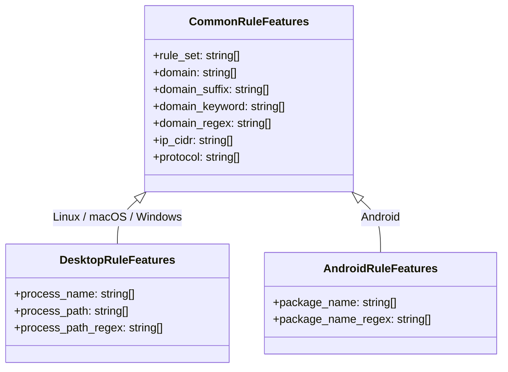
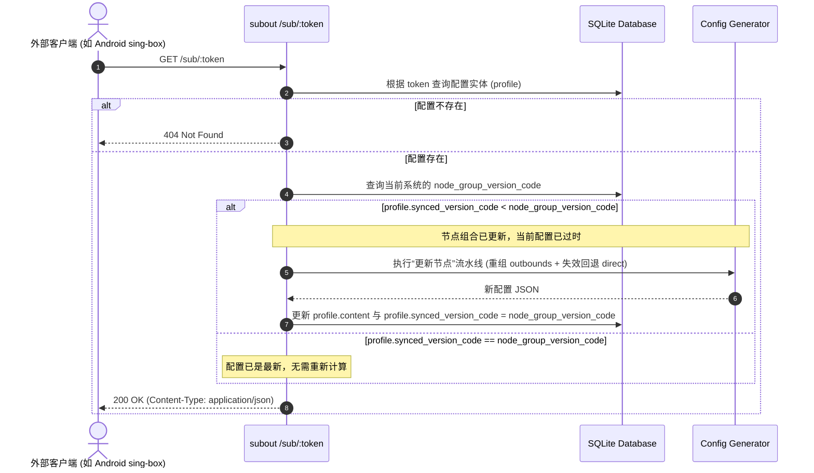
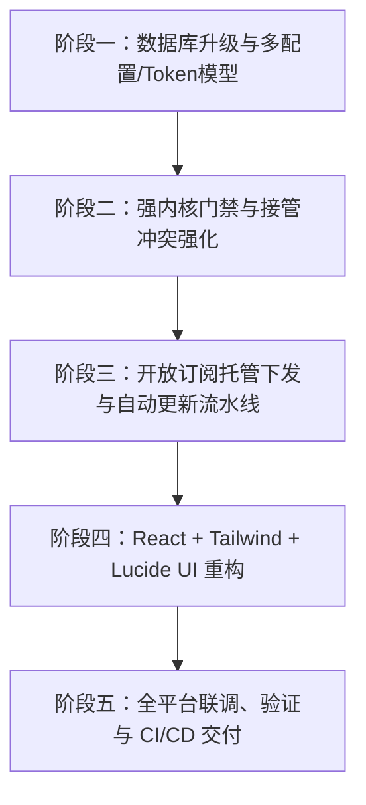

# 🚀 subout v0.3 架构升级与重构设计方案

> **文档版本**：v0.3-Draft  
> **制定日期**：2026-11-03  
> **核心定位**：轻量、高自由度、跨平台的 **sing-box 本机代理客户端** 与 **sing-box 配置订阅托管中心**。  
> **核心目标**：好用、简单、专业、跨平台、双模融合（小白模式 / 专业模式）、可作为配置托管服务、也可作为本机代理客户端。

---

## 目录

1. [项目演进背景与设计哲学](#1-项目演进背景与设计哲学)
2. [技术选型与 UI 架构重构分析](#2-技术选型与-ui-架构重构分析)
3. [基础功能与控制面板设计（强内核与接管冲突）](#3-基础功能与控制面板设计强内核与接管冲突)
4. [专业模式：多平台配置体系与订阅托管中心](#4-专业模式多平台配置体系与订阅托管中心)
5. [小白模式：极简分流与开箱即用](#5-小白模式极简分流与开箱即用)
6. [数据库架构演进（Schema Migration）](#6-数据库架构演进schema-migration)
7. [后端 API 接口演进与开放订阅协议](#7-后端-api-接口演进与开放订阅协议)
8. [自研极简 UI 组件库与视觉规范](#8-自研极简-ui-组件库与视觉规范)
9. [实施路线图与任务分解（Milestones）](#9-实施路线图与任务分解milestones)

---

## 1. 项目演进背景与设计哲学

在 `v0.1` 和 `v0.2` 版本中，`subout` 实现了多机场订阅聚合、统一节点池、基础策略组调度与小白/专业双模式，并支持 Linux、macOS、Windows 三大系统的系统代理与 TUN 模式。

随着使用场景的拓展，我们发现了现有架构的若干核心局限：

1. **角色单一**：系统被严格绑定为“本机运行代理”，无法作为云端中心为手机（Android）或其他远程设备下发配置。
2. **配置单例局限**：专业模式底层仅有一份全局 `base_config`，无法针对不同平台特性（如 Android 的应用包名分流 vs 桌面端的进程名/路径分流）保存多份专属配置。
3. **内核依赖松散**：未就绪的内核状态可能导致后续复杂的运行时错误；系统 PATH 接管缺乏对 `systemd`/`launchd`/用户保活脚本的防死锁排查。
4. **前端技术栈与视觉体验不足**：原前端基于手写 52KB CSS，缺少规范的 Design System 组件，单个页面文件膨胀（如 ConfigEditorView 高达 400KB），样式一致性与交互效率欠佳。

在 `v0.3` 中，我们将 `subout` 彻底重构为 **双重身份平台**：

- **角色 A：本机代理客户端（Local Client）**：在 Linux/macOS/Windows 宿主机上一键接管或启动 sing-box，提供小白模式快速代理或专业模式精细化网络接管。
- **角色 B：订阅配置托管服务端（Profile Hosting Service）**：运行在轻量云服务器或局域网 NAS 上，不运行 sing-box 本地代理，仅做订阅节点更新、节点组合调度、生成各平台规则配置，并通过专属 Token 链接为 Android、iOS 等客户端提供远程订阅下发。

```
                ┌────────────────────────────────────────────────────────┐
                │                     subout v0.3                        │
                ├────────────────────────────┬───────────────────────────┤
                │     本地运行代理角色        │      订阅配置托管中心角色  │
                │  (Local Client Mode)       │     (Remote Hosting Mode) │
                └─────────────┬──────────────┴─────────────┬─────────────┘
                              │                            │
                     ┌────────┴────────┐          ┌────────┴────────┐
                     │ sing-box 本地进程│          │ 外部客户端订阅拉取│
                     │ (TUN / 系统代理) │          │(Android/远程PC) │
                     └─────────────────┘          └─────────────────┘
```

---

## 2. 技术选型与 UI 架构重构分析

### 2.1 前端技术栈决策：React 18 + Tailwind CSS + Lucide React

经过对现状与用户建议的详细评估，我们正式确立 v0.3 前端技术架构：

| 维度           | 原方案 (v0.2)                    | v0.3 方案                    | 选型收益与权衡分析                                                                                                                                                                             |
| :------------- | :------------------------------- | :--------------------------- | :--------------------------------------------------------------------------------------------------------------------------------------------------------------------------------------------- |
| **核心框架**   | Vue 3 (Options/Composition 混用) | **React 18 + TypeScript**    | React 函数式组件与自定义 Hooks（如 `useServiceStatus`, `useKernelGuard`）能提供极其干净的状态与生命周期管理，类型提示严密，组件拆分逻辑更解耦。                                                |
| **样式体系**   | 手写原生 CSS (`style.css` 52KB)  | **Tailwind CSS v3 / v4**     | 彻底废弃臃肿的单文件 CSS。通过原子类实现像素级一致的深色/浅色、间距、排版与微交互，减小构建体积并消除命名冲突。                                                                                |
| **组件库策略** | 页面内临时就地拼接 DOM           | **自研轻量级 Design System** | **零引入 AntD / Element 等重型组件库**。自研一套统一风格的 `Button`, `Input`, `Select`, `Switch`, `Dialog/Modal`, `Drawer`, `Table`, `Tabs`, `Badge`, `Toast`, `Tooltip`，轻量可控、高自由度。 |
| **图标库**     | 散落的内联 SVG / Emoji           | **Lucide React**             | 统一采用 Lucide 图标集，视觉线宽与网格规范统一，支持 Tree-shaking，提升整体专业质感。                                                                                                          |
| **打包产物**   | Vite + `vite-plugin-singlefile`  | **Vite + 静态资源内嵌**      | 产物直接打包输出至 `web/dist`，Rust 后端使用 `rust-embed` 进行编译期内嵌，维持**单个可执行文件分发、零外部前端依赖**的优秀特性。                                                               |

### 2.2 视觉与交互规范

- **设计基调**：现代 Geek / Minimal Clean 风格（类似 Raycast / Tailscale / Cloudflare 控制台风格）。
- **色彩系统**：
  - 主背景：Slate-900 / Zinc-900（深色模式为主，支持浅色切换）；
  - 强调色：Cyan / Blue / Indigo（科技蓝紫调）；
  - 状态色：Emerald（成功/运行中）、Amber（告警/待同步）、Rose（错误/冲突）、Zinc（置灰/禁用）。
- **布局结构**：
  - 左侧自适应侧边栏（包含品牌、内核状态指示灯、小白/专业模式切换入口、主菜单导航）；
  - 顶部快捷状态栏（宿主系统信息、当前运行配置指示、服务启停开关）；
  - 主内容区（卡片化容器、Tab 标签页、抽屉式快速配置面板）。

---

## 3. 基础功能与控制面板设计（强内核与接管冲突）

### 3.1 目标平台与 GitHub Actions 交付矩阵

保持跨平台覆盖度，支持 3 大操作系统 × 2 种 CPU 架构共 6 个目标构件：

1. `x86_64-unknown-linux-musl`
2. `aarch64-unknown-linux-musl`
3. `x86_64-apple-darwin`
4. `aarch64-apple-darwin`
5. `x86_64-pc-windows-msvc`
6. `aarch64-pc-windows-msvc`

GitHub Actions 在 Tag 触发时自动进行交叉编译并生成多架构 Release Assets。

### 3.2 sing-box 内核强制门禁机制（Gatekeeper）

#### 3.2.1 版本命名与控制规则

程序硬编码定义以下两个版本变量：

```rust
/// 支持的内核版本模式列表（支持泛版本匹配，后续可扩充）
pub const SUPPORTED_KERNEL_VERSIONS: &[&str] = &["1.14.*"];

/// 强制绑定的标准安装版本（自动下载时使用）
pub const PINNED_KERNEL_VERSION: &str = "1.14.4";
```

#### 3.2.2 门禁拦截策略（Gatekeeper Policy）

- **版本有效性判定**：
  - 获取当前可执行文件的版本输出字符串（如 `sing-box version 1.14.4`）。
  - 匹配规则：遍历 `SUPPORTED_KERNEL_VERSIONS`，将 `1.14.*` 转换为前缀匹配 `major == 1 && minor == 14`。若不满足任一支持模式，则视为**不可用内核**。
- **UI 入口置灰逻辑**：
  - 当系统未检测到可用内核，或者版本不兼容时：
    - **仅保留「控制面板（Dashboard）」和「内核安装/下载指引」处于激活状态**；
    - 侧边栏的「订阅管理」、「节点管理」、「节点组合」、「配置管理」、「自动更新」、「网络测速」、「日志审计」等**所有其他入口全部置灰禁用，鼠标悬停提示“请先安装或配置合规的 sing-box 内核”**。
- **API 安全拦截（后端中间件）**：
  - 除 `/api/kernel/*`、`/api/system/info`、`/api/auth/*` 外，其余业务接口在内核未通过校验时，统一返回 HTTP `428 Precondition Required`，防止直接通过 API 越权操作。

#### 3.2.3 自动下载固定链接与平台映射

若检测到 PATH 或应用目录下无可用内核，程序提供固定下载源（使用 GitHub Release 官方链接与国内镜像可选）：

- `windows-amd64`: `https://github.com/SagerNet/sing-box/releases/download/v1.14.4/sing-box-1.14.4-windows-amd64.zip`
- `windows-arm64`: `https://github.com/SagerNet/sing-box/releases/download/v1.14.4/sing-box-1.14.4-windows-arm64.zip`
- `linux-amd64`: `https://github.com/SagerNet/sing-box/releases/download/v1.14.4/sing-box-1.14.4-linux-amd64.tar.gz`
- `linux-arm64`: `https://github.com/SagerNet/sing-box/releases/download/v1.14.4/sing-box-1.14.4-linux-arm64.tar.gz`
- `darwin-amd64`: `https://github.com/SagerNet/sing-box/releases/download/v1.14.4/sing-box-1.14.4-darwin-amd64.tar.gz`
- `darwin-arm64`: `https://github.com/SagerNet/sing-box/releases/download/v1.14.4/sing-box-1.14.4-darwin-arm64.tar.gz`

### 3.3 接管功能强化与冲突诊断（Linux & macOS）

当系统的 `PATH` 环境变量中发现了可用版本的 `sing-box` 时，`subout` 支持一键接管。但在实际环境中，原 sing-box 可能正处于外部服务管理器的控制之下，容易发生“接管失败死循环”。

```
用户点击“接管”
      │
      ▼
subout 发送 SIGTERM/SIGKILL 终止现有 PID
      │
      ▼
外部管理者立即拉起新进程 (systemd Restart=always / launchd KeepAlive / 保活脚本)
      │
      ▼
subout 发现端口仍被占用或进程未真正退出 ───► [判定为外部托管冲突] ───► 弹出阻断指引卡片
```

#### 3.3.1 冲突探测诊断算法

1. **服务管理器主动探测**：
   - **Linux (systemd)**：执行 `systemctl is-active sing-box` 或检查 `/etc/systemd/system/` 下是否存在 `sing-box.service`。
   - **macOS (launchd)**：执行 `launchctl list | grep sing-box` 或检查 `/Library/LaunchDaemons/`、`~/Library/LaunchAgents/` 下是否有包含 `sing-box` 的 `.plist`。
2. **保活脚本被动检测（Respawn Probe）**：
   - 若未发现系统标准服务，但在发送终止信号 1.5 秒后，检测到同路径二进制以新的 PID 再次出现，判定为存在用户自定义守护进程（如 `supervisor`、`crontab` 循环脚本或后台 Shell 循环）。
3. **友好告警与引导**：
   - 检测到冲突时，立即阻断接管动作，在 UI 上向用户展示告警弹窗，并提供对应的解除命令：
     - Linux: `sudo systemctl stop sing-box && sudo systemctl disable sing-box`
     - macOS: `sudo launchctl unload -w /Library/LaunchDaemons/xxx.plist` 或 `brew services stop sing-box`
     - 通用: 提示关闭外部保活脚本后再点击接管。

### 3.4 网络冲突安全防范提示

在控制面板醒目位置常驻提示卡片（可勾选“今日不再提示”）：

> ⚠️ **温馨提示**：在开启 `subout` 代理服务前，请确认已关闭 Clash、V2rayN、Surge 等其他代理或 VPN 工具，避免端口冲突或系统网络路由环路造成断网。

### 3.5 模式切换生命周期控制

- 初始化系统时，强制引导用户选择「小白模式」或「专业模式」。
- 模式切换时实施**严格的生命周期拦截**：
  - 若当前正有 sing-box 服务处于运行状态，**系统必须先自动执行优雅停止流程**（释放 TUN 接口、重置系统代理、注销路由表），待确认进程完全退出后，方可完成模式切换。

---

## 4. 专业模式：多平台配置体系与订阅托管中心

### 4.1 多平台配置解耦与专有特性设计

新建配置时，用户必须选择目标平台：`Linux`、`MacOS`、`Windows`、`Android`。

不同平台在分流规则编辑中具有不同的字段支持：



- **Desktop（Linux / macOS / Windows）专有字段**：
  - `process_name`：进程名称（如 `chrome`, `curl`, `git`）
  - `process_path`：进程绝对路径（如 `/usr/bin/git`, `C:\Program Files\App\app.exe`）
  - `process_path_regex`：进程路径正则表达式
- **Android 专有字段**：
  - `package_name`：应用包名（如 `com.google.android.youtube`, `com.twitter.android`）
  - `package_name_regex`：应用包名正则表达式
- **共有字段**：
  - `rule_set`, `domain`, `domain_suffix`, `domain_keyword`, `domain_regex`, `ip_cidr`, `protocol`。
- **前端渲染机制**：
  - 规则编辑器根据当前配置的 `platform` 属性，自适应切换展示对应的规则表单项，不展示无关字段。

### 4.2 节点组合与 versionCode 全局流水线

原本的“分流出站组 (Outbound Groups)”在概念与 UI 上正式更名为**“节点组合 (Node Groups)”**。

> [!IMPORTANT]
> **概念本质与技术映射关系**：  
> 所谓的“节点组合”，**在业务理解和界面描述上称为“节点组合”**（降低技术理解门槛，直观表达多个节点的归集与搭配）；**而在底层实现与最终生成的 sing-box 配置中，它严格对应的就是 `outbounds` 数组里的策略出站组（Outbound Groups）**：
>
> 1. 每个节点组合在 sing-box 的 `outbounds` 中对应一个出站项（如 `type: "selector"` 手动选择组、`type: "urltest"` 自动测速优选组、`type: "fallback"` 故障转移组等）。
> 2. 该节点组合包含的所有节点，最终体现为该 outbound 项内部的 `outbounds: ["tag_1", "tag_2", ...]` 节点标签数组。
> 3. 路由规则（`route.rules`）中的 `outbound` 目标正是指向这些节点组合的 `tag`。
>
> 之所以更名为“节点组合”，是为了彻底理顺数据流动的概念：用户添加订阅 $\to$ 聚合为节点池 $\to$ 将多个节点搭配为“节点组合” $\to$ 最终在配置的 `outbounds` 中呈现并被路由规则引用。

数据流向严格遵循：
$$\text{订阅 (Subscriptions)} \longrightarrow \text{节点池 (Nodes)} \longrightarrow \text{节点组合 (Node Groups, 对应 outbounds 策略组)} \longrightarrow \text{配置 (Configs)}$$

#### 4.2.1 versionCode 生成与刷新机制

- 只要系统中的“节点组合”发生变动（包括：新增、编辑、删除节点组合，或者因为订阅更新导致动态过滤出的节点 tags 列表产生任何增删变动），即意味着最终配置里的 `outbounds` 节点组合发生了实质变化。
- 此时系统将立刻生成全新的全局版本号：
  $$\text{versionCode} = \text{strftime}("\%Y\%m\%d\%H\%M\%S", \text{now()}) \quad (\text{如: } 20261103163500)$$
- 全局变量存储于数据库 `settings` 表的 `node_group_version_code` 键中，用于后续向客户端下发配置时的**版本比对与懒同步判断**。

### 4.3 专属订阅托管链接与懒同步下发机制（Lazy Sync Engine）

每个专业配置创建后，系统自动为其分配一个全局唯一的 `token`，并在后台提供「一键复制订阅链接」和「重置 Token」按钮。

- **订阅链接格式**：
  `http(s)://<HOST>:<PORT>/sub/<TOKEN>`
- **Token 重置**：
  点击后立即刷新该配置的 Token，历史链接全部失效并返回 404/401。
- **懒同步（Lazy Sync）处理流程**：



#### 4.3.1 统一节点更新与“失效回退 direct”容错模型

> [!IMPORTANT]
> **“更新节点”的本质与规则保全原则**：  
> 在专业模式中，无论是**程序作为配置服务给别的客户端下发配置（/sub/:token 懒同步）**，还是**自动更新中勾选“更新运行配置”**，其底层执行的都是同一个标准化的「更新节点 (Update Nodes Only)」原子流水线：
>
> 1. **非出站规则绝对不变**：配置中的 `log`、`dns`、`inbounds`、`route`（包括域名/IP/进程名/包名等平台专属分流规则）、`experimental` 保持原样，完全不被破坏或覆盖。
> 2. **全量刷新并重组 `outbounds`**：
>    - 清理并重新注入当前节点池中的**所有最新有效节点**；
>    - 重新解析所有**“节点组合”**，将各组合最新匹配/计算出的节点 tags 注入到对应的 strategy group (`outbounds`) 数组中。
> 3. **失效节点与丢失组合的“自动回退 direct”安全降级机制**：
>    - **组合内部死节点清理**：若机场下架或更名导致某些节点消失，自动从节点组合的成员列表中移除；若组合内节点被全部剔除变空，自动填入 `direct`。
>    - **分流路由规则修复**：若 `route.rules` 中某条规则的 `outbound` 指向了一个已删除的节点或不存在的节点组合，**自动将其重置为 `direct`**。
>    - **DNS detour 与 final 修复**：若 DNS 服务器的 `detour` 或 `route.final` 指向的目标不存在，**自动将其重置为 `direct`**。
>
> 这一机制保证了无论节点发生怎样的失效、迁移或增删，下发给外部客户端（如 Android sing-box）或更新给本机内核运行的配置，**100% 符合 sing-box 校验规范，绝对不会因引用不存在的 tag 而导致内核报错闪退或断网**！

这种机制的优势在于：无论何时外部客户端来拉取，都能保证拿到最新节点组合渲染的配置，而服务端在无请求时完全没有多余的空转开销。

### 4.4 本机运行与“运行配置”强校验

- **云服务器托管模式**：程序完全可以部署在 Linux VPS 上，不启动 sing-box，专门充当远程订阅更新与配置分发服务端。
- **本机运行约束**：
  - 若用户要在宿主机上开启代理，**必须在控制面板的“运行配置”下拉菜单中选择一个配置**。
  - **平台一致性强约束**：下拉菜单仅展示与当前宿主机平台严格一致的配置（如 Linux 宿主仅可选择 Linux 配置；不能选择 Windows 或 Android 配置）。
  - 若未设置运行配置，控制面板的“启动服务”开关保持禁用状态，并附带引导提示：“请先绑定当前平台的运行配置”。

### 4.5 自动更新独立页面与历史快照回滚

将自动更新由原来的设置子项提升为顶级的**「自动更新 (Auto Update)」独立页面**。

```
┌────────────────────────────────────────────────────────────────────────┐
│ 🔄 自动更新中心                                                        │
├────────────────────────────────────────────────────────────────────────┤
│ [状态看板]                                                             │
│   下次定时更新: 2026-11-04 04:00:00 (每天 04:00)                       │
│   上次执行状态: 成功 (耗时 1.8s) | 触发节点组合 versionCode: 20261103163500│
│                                                                        │
│ [更新策略设置]                                                         │
│   ☑ 启用定时自动更新 (Cron 或每隔 N 小时)                               │
│   ☑ 同步更新本机运行配置 (必须已绑定运行配置才可勾选)                   │
│   ☑ 更新后平滑热重载 sing-box 服务                                     │
│                                                                        │
│ [历史快照与回滚]                                                       │
│   * 2026-11-03 16:00:00 | 覆盖运行配置 [默认Linux配置] | [一键回滚]   │
│   * 2026-11-02 16:00:00 | 覆盖运行配置 [默认Linux配置] | [一键回滚]   │
└────────────────────────────────────────────────────────────────────────┘
```

- **更新行为原则**：
  - 自动更新执行完整的链式管道：`拉取订阅 -> 更新节点池 -> 重新计算节点组合 -> 刷新系统 versionCode -> 刷新当前运行配置`。
  - **纯节点刷新模式（Node-Only Refresh）**：覆盖运行配置时，严格执行 4.3.1 节定义的流水线，即**仅刷新 `outbounds` 节点池与节点组合，原有分流规则、DNS、入站、平台专属规则完全保留**；若存在丢失的节点或组合，将其在规则与策略组中的引用自动降级重置为 `direct`。
  - **非增量垃圾数据原则**：自动更新不会在数据库无限制新建配置条目，而是直接覆盖更新当前绑定的“运行配置”。
  - **历史快照追溯**：每次自动更新覆盖前，将变更前的数据保存为历史快照（Snapshot）。用户在「自动更新」页面随时可以点击“回滚”恢复至任意历史时间点的配置。

---

## 5. 小白模式：极简分流与开箱即用

小白模式面向追求“免折腾、开箱即用”的普通用户，**专供程序宿主机本机使用，不生成外部订阅托管链接**。

### 5.1 架构与平台自适应原则

- **无平台专属规则**：小白模式不涉及进程名、包名等复杂分流，仅基于域名和 IP 数据库分流。
- **单例配置**：系统全局仅维持一份小白模式配置，修改后即刻对本机生效。
- **Inbounds 自动平台适配**：
  - 检测宿主系统（macOS / Linux / Windows），自动推荐并生成最佳入站参数（TUN 虚拟网卡或 Mixed 混合端口），用户无需手动填写网卡名或路由表配置。

### 5.2 四种固定出站（Outbounds）分流模式

小白模式提供清晰易懂的 4 种路由策略：

| 分流模式              | 路由与 DNS 行为逻辑                                                                      | 适用场景                   |
| :-------------------- | :--------------------------------------------------------------------------------------- | :------------------------- |
| **全部直连**          | 所有网络请求绕过代理，直接使用本地网络与 Local DNS。**（此时出口节点选择器置灰不可选）** | 临时暂停代理无需关闭客户端 |
| **全部代理**          | 所有非局域网流量全部转发至选中的代理出口节点，使用 Remote/FakeIP DNS 解析。              | 全局翻墙、排除国内分流干扰 |
| **GFW 列表代理**      | 仅被 GFW 阻断的境外域名走代理，国内及未受限国外域名走直连。                              | 极致节省代理流量           |
| **智能分流** _(推荐)_ | 国内域名与国内 IP (`geosite-cn`, `geoip-cn`) 走直连；其余全部走代理。                    | 日常工作与娱乐最佳平衡     |

### 5.3 顶级优先级的额外出口配置（Priority Rules）

在所有分流模式（除全部直连）中，系统强制在规则链最顶端注入两条最高优先级规则：

1. **广告与恶意追踪拦截**：`geosite:category-ads-all` $\longrightarrow$ `block` (DNS `NOERROR`)。
2. **局域网私有地址直连**：`geoip:private` $\longrightarrow$ `direct`。

### 5.4 出口节点选择策略

在小白模式下，用户可自由选择出站节点方案：

1. **自动测速 (urltest)**：将节点池中所有可用节点编入自动优选组，以 `https://www.gstatic.com/generate_204` 为测速目标，自动切换最低延迟节点。
2. **手动指定节点**：用户在下拉列表中指定一个特定节点。
3. **互斥约束**：若用户勾选了“全部直连”，则出口节点选择器自动锁定置灰，避免无效配置。

### 5.5 规则集完整性保障（Rule-Set Completeness）

为杜绝“国内域名误走代理”或“国外域名 DNS 污染”，系统内置并自动更新以下官方标准 srs 规则集：

- `geosite-category-ads-all`（广告规则集）
- `geosite-cn`（国内域名）
- `geosite-geolocation-!cn`（非大陆境外主流域名）
- `geoip-cn`（中国大陆 IP 网段）
- `geoip-private`（局域网与私有 IP 网段）

---

## 6. 数据库架构演进（Schema Migration）

为支撑 v0.3 的多配置托管与版本控制，数据库结构需执行以下平滑迁移：

### 6.1 新增 `configs` 表（多配置与托管中心）

```sql
CREATE TABLE IF NOT EXISTS configs (
    id INTEGER PRIMARY KEY AUTOINCREMENT,
    name TEXT NOT NULL,                         -- 配置显示名称
    platform TEXT NOT NULL,                     -- 'linux' | 'macos' | 'windows' | 'android'
    description TEXT,                           -- 备注说明
    token TEXT UNIQUE NOT NULL,                 -- 专属订阅 Token (UUID)
    version_code INTEGER DEFAULT 0,             -- 最后同步的节点组合版本号
    content TEXT NOT NULL,                      -- 完整 sing-box 配置 JSON
    is_running_config INTEGER DEFAULT 0,        -- 是否为当前宿主机绑定的运行配置
    created_at TEXT DEFAULT (datetime('now', 'localtime')),
    updated_at TEXT DEFAULT (datetime('now', 'localtime'))
);

CREATE INDEX IF NOT EXISTS idx_configs_token ON configs(token);
CREATE INDEX IF NOT EXISTS idx_configs_platform ON configs(platform);
```

### 6.2 扩展 `settings` 表系统级配置键

- `app_mode`：`"simple"` | `"expert"`（当前系统模式）
- `running_config_id`：当前绑定的运行配置 ID（整数）
- `node_group_version_code`：系统当前最新的节点组合版本号（整数，格式 `YYYYMMDDHHmmss`）
- `auto_update_cron`：自动更新定时表达式
- `auto_update_sync_running`：是否自动更新并重载本机运行配置（`0` 或 `1`）

### 6.3 重命名与增强 `outbound_groups` 表

- **定位升级**：表名保持兼容或重命名，业务与 UI 语义全面升级为“节点组合（Node Groups）”，底层依然存储待组装为 sing-box `outbounds` 的策略组定义（类型如 selector/urltest/fallback，静态节点列表 static_nodes，动态过滤规则 node_types/subscriptions/keywords）。
- 增加 `updated_at` 字段，任何 CRUD 操作通过触发器自动更新时间并刷新 `node_group_version_code`。

### 6.4 强化 `config_history` 快照表

- 增加 `config_id` 外键关联，记录是针对哪一份配置（特别是运行配置）产生的自动更新或手动保存快照，支持精准版本回滚。

---

## 7. 后端 API 接口演进与开放订阅协议

### 7.1 新增与改造核心 API 列表

```text
/api/
├── kernel/
│   ├── GET  /info                      # 内核版本信息 (返回支持列表、绑定版本、当前满足状态)
│   ├── POST /download                  # 下载 1.14.4 内核
│   └── POST /takeover-diagnose         # 接管冲突深度诊断 (检测 systemd/launchd/保活脚本)
│
├── system/
│   ├── GET  /mode                      # 获取当前模式 (simple/expert)
│   └── POST /mode                      # 切换模式 (自动停止旧服务并切换)
│
├── node-groups/                        # 原 /api/groups 更名
│   ├── GET  /                          # 获取节点组合列表 (带当前系统 versionCode)
│   ├── POST /                          # 新建组合 (自动更新全局 versionCode)
│   ├── PUT  /:id                       # 修改组合 (自动更新全局 versionCode)
│   └── DELETE /:id                     # 删除组合 (自动更新全局 versionCode)
│
├── configs/                            # 专业模式多配置管理
│   ├── GET  /                          # 获取配置列表 (支持按 platform 过滤)
│   ├── POST /                          # 新建平台配置 (自动生成 Token)
│   ├── GET  /:id                       # 获取配置详情与内容
│   ├── PUT  /:id                       # 修改配置
│   ├── DELETE /:id                     # 删除配置 (运行中的配置不可删除)
│   ├── POST /:id/reset-token           # 重置订阅 Token
│   └── POST /set-running               # 绑定本机运行配置 (校验平台一致性)
│
├── auto-update/                        # 自动更新中心独立模块
│   ├── GET  /settings                  # 获取定时更新与自动重载设置
│   ├── POST /settings                  # 保存设置
│   ├── POST /trigger                   # 立即手动触发全链式自动更新
│   ├── GET  /history                   # 获取更新历史快照
│   └── POST /history/:id/rollback      # 回滚指定快照到运行配置
│
└── simple-config/                      # 小白模式配置接口 (维持单例模型)
    ├── GET  /
    └── POST /

/sub/:token                             # 开放客户端订阅入口 (免 Auth，根据 token 鉴权与懒同步)
```

### 7.2 开放订阅端点协议规范（`/sub/:token`）

- **方法**：`GET`
- **鉴权方式**：URL Token 校验
- **请求头支持**：标准 HTTP 客户端（无需额外 Header，支持 Android sing-box、curl 等拉取）
- **响应头**：
  - `Content-Type: application/json; charset=utf-8`
  - `X-Config-Version-Code: 20261103163500`
  - `X-Profile-Platform: android`
- **响应内容**：合法的 sing-box 完整配置 JSON。

---

## 8. 自研极简 UI 组件库与视觉规范

为了避免引入笨重、样式难以深度覆盖的第三方组件库（如 AntD 或 Element），同时杜绝原本手写 52KB CSS 的失控混乱，前端将在 `web/src/components/ui/` 中自研一套**轻量、类型安全、基于 Tailwind CSS 的无外部依赖组件库**：

```
web/src/components/ui/
├── Button.tsx         # 按钮 (Primary, Secondary, Danger, Ghost, Outline, Loading 态)
├── Input.tsx          # 输入框 (前缀/后缀图标, 清除按钮, 校验高亮)
├── Select.tsx         # 下拉选择器 (支持自适应宽、带搜索)
├── Switch.tsx         # 切换开关 (支持平滑过渡与禁用态)
├── Dialog.tsx         # 模态对话框 (基于 Portal, 遮罩毛玻璃, 键盘 ESC 监听)
├── Drawer.tsx         # 抽屉滑出层 (用于复杂的配置编辑与规则树)
├── Table.tsx          # 表格 (表头排序, 分页, 空数据占位)
├── Tabs.tsx           # 选项卡 (卡片式或胶囊式切换)
├── Badge.tsx          # 状态徽章 (运行中/已停止/平台标识/版本号)
├── Toast.tsx          # 轻提示通知 (成功, 警告, 错误浮动通知)
├── Tooltip.tsx        # 文字提示气泡
└── CopyButton.tsx     # 一键复制按钮 (带复制成功状态切换动画)
```

### 8.1 典型页面交互设计

1. **Dashboard 控制面板**：
   - **内核就绪警告条**：若内核不满足 `1.14.*`，屏幕中央弹出强引导卡片，侧边栏变灰，仅允许下载内核或排查接管。
   - **运行状态指示与冲突提示**：展示 CPU、内存、当前运行配置名、当前模式标签、外网测试快捷探针、以及“请关闭其他代理”安全提醒。
   - **运行配置选择器**：下拉框根据宿主 OS 动态过滤出合法配置供绑定。
2. **专业配置管理（Profiles）**：
   - 卡片式与列表式视图，直观显示各配置的平台标签（Linux / macOS / Windows / Android）；
   - 每个卡片具备：配置名称、平台图标、当前版本号、**「复制订阅链接」**、**「重置 Token」**、**「在线编辑」**、**「设为本机运行」**。
3. **节点组合（原出站组）**：
   - 展示当前系统全局 `versionCode`；
   - 支持通过标签、节点类型、机场来源动态规则聚合节点，实时预览包含的节点数量与列表。
4. **自动更新中心（Auto Update）**：
   - 独立页面，清晰呈现定时调度配置、最近更新日志流、历史快照时间轴与一键回滚按钮。

---

## 9. 实施路线图与任务分解（Milestones）

为确保升级过程严谨可控、便于阶段性验证，建议按以下 5 个阶段推进开发：



### 阶段一：数据库升级与多配置/Token模型 (Database & Core Models)

- [x] 编写数据库 Migration 逻辑：创建 `configs` 表，迁移老旧单一 `base_config`。
- [x] 在 `settings` 中增加 `node_group_version_code`、`running_config_id`、`app_mode`。
- [x] 将“出站组 (outbound_groups)”在后端代码全面重构为“节点组合 (Node Groups)”。
- [x] 实现节点组合变动时自动计算生成 `YYYYMMDDHHmmss` 格式的 `versionCode`。

### 阶段二：强内核门禁与接管冲突强化 (Kernel & Platform Guard)

- [x] 改造 `src/kernel.rs`：硬编码 `SUPPORTED_KERNEL_VERSIONS = ["1.14.*"]` 与 `PINNED_KERNEL_VERSION = "1.14.4"`。
- [x] 编写内核版本模式匹配算法（支持通配泛版本与语义版本判定）。
- [x] 实现接管冲突强化探测器：针对 Linux (systemd) 与 macOS (launchd) 探测服务状态与 Respawn 循环。
- [x] 增加后端中间件：内核未就绪时除白名单接口外全部返回 `428 Precondition Required`。
- [x] 完善模式切换生命周期控制：切换前必须停止现有服务并释放网络资源。

### 阶段三：开放订阅托管下发与自动更新流水线 (Hosting & Auto Update)

- [x] 实现 `/sub/:token` 开放订阅端点，集成懒同步（Lazy Sync）机制（比对版本号并按需渲染）。
- [x] 实现多平台分流规则差异化支持（Linux/Mac/Win 进程名/路径 vs Android 包名）。
- [x] 改造自动更新流水线：
  - 定时触发链式更新；
  - 覆盖指定运行配置；
  - 生成带时间戳的历史快照；
  - 实现快照回滚功能。
- [x] 完善小白模式分流规则库与顶级优先级出站规则（广告拦截、私有局域网直连）。

### 阶段四：React + Tailwind + Lucide 前端重构 (Frontend Modernization)

- [x] 初始化 `web/` 工程：基于 React 18 + TypeScript + Vite + Tailwind CSS + Lucide React。
- [x] 构建自研基础 UI 组件库（Button, Input, Select, Switch, Dialog, Drawer, Table, Tabs, Badge, Toast 等）。
- [x] 实现全界面路由与全局内核门禁守卫（内核异常时自动锁定次要功能菜单）。
- [x] 开发控制面板（Dashboard）、小白模式（Simple）、节点管理（Nodes）、节点组合（Node Groups）。
- [x] 开发配置中心（Profiles，含平台选择、专有规则表单、一键复制链接、重置 Token）。
- [x] 开发独立的自动更新中心页面（Auto Update）与快照回滚交互。

### 阶段五：全平台联调、验证与 CI/CD 交付 (Testing & Release)

- [x] Linux、macOS、Windows 本机运行代理功能联调（TUN 模式、系统代理切换）。
- [x] Android sing-box 客户端通过 `/sub/:token` 拉取订阅与分流规则实测。
- [x] 验证接管冲突场景（故意开启 systemd 服务测试冲突阻断提示）。
- [x] 验证 GitHub Actions 6 大目标平台编译打包流程（`release.yml` 验证单二进制打包）。

---

## 10. 确认与后续行动建议

本计划已详细整合了您的业务目标与工程最佳实践建议。请审阅此方案：

1. 若对上述架构规划（如前端自研 Design System、versionCode 逻辑、懒同步机制、冲突检测策略）有任何修改或增删想法，可直接提出调整意见；
2. 待方案确认定稿后，我们将严格依照此路线图分阶段推进编码实现。
