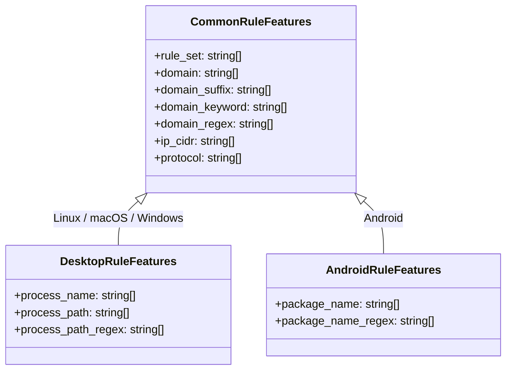
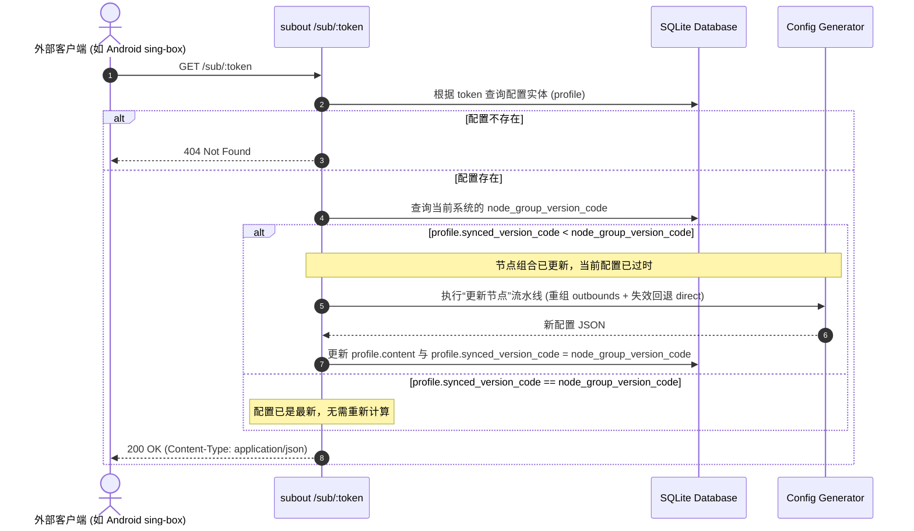
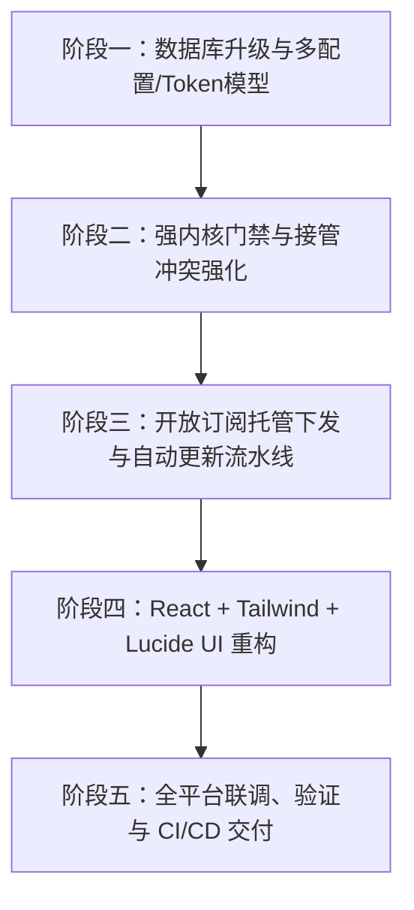

# 🚀 subout v0.3 架构升级与重构设计方案

> **文档版本**：v0.3-Draft  
> **制定日期**：2026-11-03  
> **核心定位**：轻量、高自由度、跨平台的 **sing-box 本机代理客户端** 与 **sing-box 配置订阅托管中心**。  
> **核心目标**：好用、简单、专业、跨平台、双模融合（小白模式 / 专业模式）、可作为配置托管服务、也可作为本机代理客户端。

---

## 目录

1. [项目演进背景与设计哲学](#1-项目演进背景与设计哲学)
2. [技术选型与 UI 架构重构分析](#2-技术选型与-ui-架构重构分析)
3. [基础功能与控制面板设计（强内核与接管冲突）](#3-基础功能与控制面板设计强内核与接管冲突)
4. [专业模式：多平台配置体系与订阅托管中心](#4-专业模式多平台配置体系与订阅托管中心)
5. [小白模式：极简分流与开箱即用](#5-小白模式极简分流与开箱即用)
6. [数据库架构演进（Schema Migration）](#6-数据库架构演进schema-migration)
7. [后端 API 接口演进与开放订阅协议](#7-后端-api-接口演进与开放订阅协议)
8. [自研极简 UI 组件库与视觉规范](#8-自研极简-ui-组件库与视觉规范)
9. [实施路线图与任务分解（Milestones）](#9-实施路线图与任务分解milestones)

---

## 1. 项目演进背景与设计哲学

在 `v0.1` 和 `v0.2` 版本中，`subout` 实现了多机场订阅聚合、统一节点池、基础策略组调度与小白/专业双模式，并支持 Linux、macOS、Windows 三大系统的系统代理与 TUN 模式。

随着使用场景的拓展，我们发现了现有架构的若干核心局限：

1. **角色单一**：系统被严格绑定为“本机运行代理”，无法作为云端中心为手机（Android）或其他远程设备下发配置。
2. **配置单例局限**：专业模式底层仅有一份全局 `base_config`，无法针对不同平台特性（如 Android 的应用包名分流 vs 桌面端的进程名/路径分流）保存多份专属配置。
3. **内核依赖松散**：未就绪的内核状态可能导致后续复杂的运行时错误；系统 PATH 接管缺乏对 `systemd`/`launchd`/用户保活脚本的防死锁排查。
4. **前端技术栈与视觉体验不足**：原前端基于手写 52KB CSS，缺少规范的 Design System 组件，单个页面文件膨胀（如 ConfigEditorView 高达 400KB），样式一致性与交互效率欠佳。

在 `v0.3` 中，我们将 `subout` 彻底重构为 **双重身份平台**：

- **角色 A：本机代理客户端（Local Client）**：在 Linux/macOS/Windows 宿主机上一键接管或启动 sing-box，提供小白模式快速代理或专业模式精细化网络接管。
- **角色 B：订阅配置托管服务端（Profile Hosting Service）**：运行在轻量云服务器或局域网 NAS 上，不运行 sing-box 本地代理，仅做订阅节点更新、节点组合调度、生成各平台规则配置，并通过专属 Token 链接为 Android、iOS 等客户端提供远程订阅下发。

```
                ┌────────────────────────────────────────────────────────┐
                │                     subout v0.3                        │
                ├────────────────────────────┬───────────────────────────┤
                │     本地运行代理角色        │      订阅配置托管中心角色  │
                │  (Local Client Mode)       │     (Remote Hosting Mode) │
                └─────────────┬──────────────┴─────────────┬─────────────┘
                              │                            │
                     ┌────────┴────────┐          ┌────────┴────────┐
                     │ sing-box 本地进程│          │ 外部客户端订阅拉取│
                     │ (TUN / 系统代理) │          │(Android/远程PC) │
                     └─────────────────┘          └─────────────────┘
```

---

## 2. 技术选型与 UI 架构重构分析

### 2.1 前端技术栈决策：React 18 + Tailwind CSS + Lucide React

经过对现状与用户建议的详细评估，我们正式确立 v0.3 前端技术架构：

| 维度           | 原方案 (v0.2)                    | v0.3 方案                    | 选型收益与权衡分析                                                                                                                                                                             |
| :------------- | :------------------------------- | :--------------------------- | :--------------------------------------------------------------------------------------------------------------------------------------------------------------------------------------------- |
| **核心框架**   | Vue 3 (Options/Composition 混用) | **React 18 + TypeScript**    | React 函数式组件与自定义 Hooks（如 `useServiceStatus`, `useKernelGuard`）能提供极其干净的状态与生命周期管理，类型提示严密，组件拆分逻辑更解耦。                                                |
| **样式体系**   | 手写原生 CSS (`style.css` 52KB)  | **Tailwind CSS v3 / v4**     | 彻底废弃臃肿的单文件 CSS。通过原子类实现像素级一致的深色/浅色、间距、排版与微交互，减小构建体积并消除命名冲突。                                                                                |
| **组件库策略** | 页面内临时就地拼接 DOM           | **自研轻量级 Design System** | **零引入 AntD / Element 等重型组件库**。自研一套统一风格的 `Button`, `Input`, `Select`, `Switch`, `Dialog/Modal`, `Drawer`, `Table`, `Tabs`, `Badge`, `Toast`, `Tooltip`，轻量可控、高自由度。 |
| **图标库**     | 散落的内联 SVG / Emoji           | **Lucide React**             | 统一采用 Lucide 图标集，视觉线宽与网格规范统一，支持 Tree-shaking，提升整体专业质感。                                                                                                          |
| **打包产物**   | Vite + `vite-plugin-singlefile`  | **Vite + 静态资源内嵌**      | 产物直接打包输出至 `web/dist`，Rust 后端使用 `rust-embed` 进行编译期内嵌，维持**单个可执行文件分发、零外部前端依赖**的优秀特性。                                                               |

### 2.2 视觉与交互规范

- **设计基调**：现代 Geek / Minimal Clean 风格（类似 Raycast / Tailscale / Cloudflare 控制台风格）。
- **色彩系统**：
  - 主背景：Slate-900 / Zinc-900（深色模式为主，支持浅色切换）；
  - 强调色：Cyan / Blue / Indigo（科技蓝紫调）；
  - 状态色：Emerald（成功/运行中）、Amber（告警/待同步）、Rose（错误/冲突）、Zinc（置灰/禁用）。
- **布局结构**：
  - 左侧自适应侧边栏（包含品牌、内核状态指示灯、小白/专业模式切换入口、主菜单导航）；
  - 顶部快捷状态栏（宿主系统信息、当前运行配置指示、服务启停开关）；
  - 主内容区（卡片化容器、Tab 标签页、抽屉式快速配置面板）。

---

## 3. 基础功能与控制面板设计（强内核与接管冲突）

### 3.1 目标平台与 GitHub Actions 交付矩阵

保持跨平台覆盖度，支持 3 大操作系统 × 2 种 CPU 架构共 6 个目标构件：

1. `x86_64-unknown-linux-musl`
2. `aarch64-unknown-linux-musl`
3. `x86_64-apple-darwin`
4. `aarch64-apple-darwin`
5. `x86_64-pc-windows-msvc`
6. `aarch64-pc-windows-msvc`

GitHub Actions 在 Tag 触发时自动进行交叉编译并生成多架构 Release Assets。

### 3.2 sing-box 内核强制门禁机制（Gatekeeper）

#### 3.2.1 版本命名与控制规则

程序硬编码定义以下两个版本变量：

```rust
/// 支持的内核版本模式列表（支持泛版本匹配，后续可扩充）
pub const SUPPORTED_KERNEL_VERSIONS: &[&str] = &["1.14.*"];

/// 强制绑定的标准安装版本（自动下载时使用）
pub const PINNED_KERNEL_VERSION: &str = "1.14.4";
```

#### 3.2.2 门禁拦截策略（Gatekeeper Policy）

- **版本有效性判定**：
  - 获取当前可执行文件的版本输出字符串（如 `sing-box version 1.14.4`）。
  - 匹配规则：遍历 `SUPPORTED_KERNEL_VERSIONS`，将 `1.14.*` 转换为前缀匹配 `major == 1 && minor == 14`。若不满足任一支持模式，则视为**不可用内核**。
- **UI 入口置灰逻辑**：
  - 当系统未检测到可用内核，或者版本不兼容时：
    - **仅保留「控制面板（Dashboard）」和「内核安装/下载指引」处于激活状态**；
    - 侧边栏的「订阅管理」、「节点管理」、「节点组合」、「配置管理」、「自动更新」、「网络测速」、「日志审计」等**所有其他入口全部置灰禁用，鼠标悬停提示“请先安装或配置合规的 sing-box 内核”**。
- **API 安全拦截（后端中间件）**：
  - 除 `/api/kernel/*`、`/api/system/info`、`/api/auth/*` 外，其余业务接口在内核未通过校验时，统一返回 HTTP `428 Precondition Required`，防止直接通过 API 越权操作。

#### 3.2.3 自动下载固定链接与平台映射

若检测到 PATH 或应用目录下无可用内核，程序提供固定下载源（使用 GitHub Release 官方链接与国内镜像可选）：

- `windows-amd64`: `https://github.com/SagerNet/sing-box/releases/download/v1.14.4/sing-box-1.14.4-windows-amd64.zip`
- `windows-arm64`: `https://github.com/SagerNet/sing-box/releases/download/v1.14.4/sing-box-1.14.4-windows-arm64.zip`
- `linux-amd64`: `https://github.com/SagerNet/sing-box/releases/download/v1.14.4/sing-box-1.14.4-linux-amd64.tar.gz`
- `linux-arm64`: `https://github.com/SagerNet/sing-box/releases/download/v1.14.4/sing-box-1.14.4-linux-arm64.tar.gz`
- `darwin-amd64`: `https://github.com/SagerNet/sing-box/releases/download/v1.14.4/sing-box-1.14.4-darwin-amd64.tar.gz`
- `darwin-arm64`: `https://github.com/SagerNet/sing-box/releases/download/v1.14.4/sing-box-1.14.4-darwin-arm64.tar.gz`

### 3.3 接管功能强化与冲突诊断（Linux & macOS）

当系统的 `PATH` 环境变量中发现了可用版本的 `sing-box` 时，`subout` 支持一键接管。但在实际环境中，原 sing-box 可能正处于外部服务管理器的控制之下，容易发生“接管失败死循环”。

```
用户点击“接管”
      │
      ▼
subout 发送 SIGTERM/SIGKILL 终止现有 PID
      │
      ▼
外部管理者立即拉起新进程 (systemd Restart=always / launchd KeepAlive / 保活脚本)
      │
      ▼
subout 发现端口仍被占用或进程未真正退出 ───► [判定为外部托管冲突] ───► 弹出阻断指引卡片
```

#### 3.3.1 冲突探测诊断算法

1. **服务管理器主动探测**：
   - **Linux (systemd)**：执行 `systemctl is-active sing-box` 或检查 `/etc/systemd/system/` 下是否存在 `sing-box.service`。
   - **macOS (launchd)**：执行 `launchctl list | grep sing-box` 或检查 `/Library/LaunchDaemons/`、`~/Library/LaunchAgents/` 下是否有包含 `sing-box` 的 `.plist`。
2. **保活脚本被动检测（Respawn Probe）**：
   - 若未发现系统标准服务，但在发送终止信号 1.5 秒后，检测到同路径二进制以新的 PID 再次出现，判定为存在用户自定义守护进程（如 `supervisor`、`crontab` 循环脚本或后台 Shell 循环）。
3. **友好告警与引导**：
   - 检测到冲突时，立即阻断接管动作，在 UI 上向用户展示告警弹窗，并提供对应的解除命令：
     - Linux: `sudo systemctl stop sing-box && sudo systemctl disable sing-box`
     - macOS: `sudo launchctl unload -w /Library/LaunchDaemons/xxx.plist` 或 `brew services stop sing-box`
     - 通用: 提示关闭外部保活脚本后再点击接管。

### 3.4 网络冲突安全防范提示

在控制面板醒目位置常驻提示卡片（可勾选“今日不再提示”）：

> ⚠️ **温馨提示**：在开启 `subout` 代理服务前，请确认已关闭 Clash、V2rayN、Surge 等其他代理或 VPN 工具，避免端口冲突或系统网络路由环路造成断网。

### 3.5 模式切换生命周期控制

- 初始化系统时，强制引导用户选择「小白模式」或「专业模式」。
- 模式切换时实施**严格的生命周期拦截**：
  - 若当前正有 sing-box 服务处于运行状态，**系统必须先自动执行优雅停止流程**（释放 TUN 接口、重置系统代理、注销路由表），待确认进程完全退出后，方可完成模式切换。

---

## 4. 专业模式：多平台配置体系与订阅托管中心

### 4.1 多平台配置解耦与专有特性设计

新建配置时，用户必须选择目标平台：`Linux`、`MacOS`、`Windows`、`Android`。

不同平台在分流规则编辑中具有不同的字段支持：



- **Desktop（Linux / macOS / Windows）专有字段**：
  - `process_name`：进程名称（如 `chrome`, `curl`, `git`）
  - `process_path`：进程绝对路径（如 `/usr/bin/git`, `C:\Program Files\App\app.exe`）
  - `process_path_regex`：进程路径正则表达式
- **Android 专有字段**：
  - `package_name`：应用包名（如 `com.google.android.youtube`, `com.twitter.android`）
  - `package_name_regex`：应用包名正则表达式
- **共有字段**：
  - `rule_set`, `domain`, `domain_suffix`, `domain_keyword`, `domain_regex`, `ip_cidr`, `protocol`。
- **前端渲染机制**：
  - 规则编辑器根据当前配置的 `platform` 属性，自适应切换展示对应的规则表单项，不展示无关字段。

### 4.2 节点组合与 versionCode 全局流水线

原本的“分流出站组 (Outbound Groups)”在概念与 UI 上正式更名为**“节点组合 (Node Groups)”**。

> [!IMPORTANT]
> **概念本质与技术映射关系**：  
> 所谓的“节点组合”，**在业务理解和界面描述上称为“节点组合”**（降低技术理解门槛，直观表达多个节点的归集与搭配）；**而在底层实现与最终生成的 sing-box 配置中，它严格对应的就是 `outbounds` 数组里的策略出站组（Outbound Groups）**：
>
> 1. 每个节点组合在 sing-box 的 `outbounds` 中对应一个出站项（如 `type: "selector"` 手动选择组、`type: "urltest"` 自动测速优选组、`type: "fallback"` 故障转移组等）。
> 2. 该节点组合包含的所有节点，最终体现为该 outbound 项内部的 `outbounds: ["tag_1", "tag_2", ...]` 节点标签数组。
> 3. 路由规则（`route.rules`）中的 `outbound` 目标正是指向这些节点组合的 `tag`。
>
> 之所以更名为“节点组合”，是为了彻底理顺数据流动的概念：用户添加订阅 $\to$ 聚合为节点池 $\to$ 将多个节点搭配为“节点组合” $\to$ 最终在配置的 `outbounds` 中呈现并被路由规则引用。

数据流向严格遵循：
$$\text{订阅 (Subscriptions)} \longrightarrow \text{节点池 (Nodes)} \longrightarrow \text{节点组合 (Node Groups, 对应 outbounds 策略组)} \longrightarrow \text{配置 (Configs)}$$

#### 4.2.1 versionCode 生成与刷新机制

- 只要系统中的“节点组合”发生变动（包括：新增、编辑、删除节点组合，或者因为订阅更新导致动态过滤出的节点 tags 列表产生任何增删变动），即意味着最终配置里的 `outbounds` 节点组合发生了实质变化。
- 此时系统将立刻生成全新的全局版本号：
  $$\text{versionCode} = \text{strftime}("\%Y\%m\%d\%H\%M\%S", \text{now()}) \quad (\text{如: } 20261103163500)$$
- 全局变量存储于数据库 `settings` 表的 `node_group_version_code` 键中，用于后续向客户端下发配置时的**版本比对与懒同步判断**。

### 4.3 专属订阅托管链接与懒同步下发机制（Lazy Sync Engine）

每个专业配置创建后，系统自动为其分配一个全局唯一的 `token`，并在后台提供「一键复制订阅链接」和「重置 Token」按钮。

- **订阅链接格式**：
  `http(s)://<HOST>:<PORT>/sub/<TOKEN>`
- **Token 重置**：
  点击后立即刷新该配置的 Token，历史链接全部失效并返回 404/401。
- **懒同步（Lazy Sync）处理流程**：



#### 4.3.1 统一节点更新与“失效回退 direct”容错模型

> [!IMPORTANT]
> **“更新节点”的本质与规则保全原则**：  
> 在专业模式中，无论是**程序作为配置服务给别的客户端下发配置（/sub/:token 懒同步）**，还是**自动更新中勾选“更新运行配置”**，其底层执行的都是同一个标准化的「更新节点 (Update Nodes Only)」原子流水线：
>
> 1. **非出站规则绝对不变**：配置中的 `log`、`dns`、`inbounds`、`route`（包括域名/IP/进程名/包名等平台专属分流规则）、`experimental` 保持原样，完全不被破坏或覆盖。
> 2. **全量刷新并重组 `outbounds`**：
>    - 清理并重新注入当前节点池中的**所有最新有效节点**；
>    - 重新解析所有**“节点组合”**，将各组合最新匹配/计算出的节点 tags 注入到对应的 strategy group (`outbounds`) 数组中。
> 3. **失效节点与丢失组合的“自动回退 direct”安全降级机制**：
>    - **组合内部死节点清理**：若机场下架或更名导致某些节点消失，自动从节点组合的成员列表中移除；若组合内节点被全部剔除变空，自动填入 `direct`。
>    - **分流路由规则修复**：若 `route.rules` 中某条规则的 `outbound` 指向了一个已删除的节点或不存在的节点组合，**自动将其重置为 `direct`**。
>    - **DNS detour 与 final 修复**：若 DNS 服务器的 `detour` 或 `route.final` 指向的目标不存在，**自动将其重置为 `direct`**。
>
> 这一机制保证了无论节点发生怎样的失效、迁移或增删，下发给外部客户端（如 Android sing-box）或更新给本机内核运行的配置，**100% 符合 sing-box 校验规范，绝对不会因引用不存在的 tag 而导致内核报错闪退或断网**！

这种机制的优势在于：无论何时外部客户端来拉取，都能保证拿到最新节点组合渲染的配置，而服务端在无请求时完全没有多余的空转开销。

### 4.4 本机运行与“运行配置”强校验

- **云服务器托管模式**：程序完全可以部署在 Linux VPS 上，不启动 sing-box，专门充当远程订阅更新与配置分发服务端。
- **本机运行约束**：
  - 若用户要在宿主机上开启代理，**必须在控制面板的“运行配置”下拉菜单中选择一个配置**。
  - **平台一致性强约束**：下拉菜单仅展示与当前宿主机平台严格一致的配置（如 Linux 宿主仅可选择 Linux 配置；不能选择 Windows 或 Android 配置）。
  - 若未设置运行配置，控制面板的“启动服务”开关保持禁用状态，并附带引导提示：“请先绑定当前平台的运行配置”。

### 4.5 自动更新独立页面与历史快照回滚

将自动更新由原来的设置子项提升为顶级的**「自动更新 (Auto Update)」独立页面**。

```
┌────────────────────────────────────────────────────────────────────────┐
│ 🔄 自动更新中心                                                        │
├────────────────────────────────────────────────────────────────────────┤
│ [状态看板]                                                             │
│   下次定时更新: 2026-11-04 04:00:00 (每天 04:00)                       │
│   上次执行状态: 成功 (耗时 1.8s) | 触发节点组合 versionCode: 20261103163500│
│                                                                        │
│ [更新策略设置]                                                         │
│   ☑ 启用定时自动更新 (Cron 或每隔 N 小时)                               │
│   ☑ 同步更新本机运行配置 (必须已绑定运行配置才可勾选)                   │
│   ☑ 更新后平滑热重载 sing-box 服务                                     │
│                                                                        │
│ [历史快照与回滚]                                                       │
│   * 2026-11-03 16:00:00 | 覆盖运行配置 [默认Linux配置] | [一键回滚]   │
│   * 2026-11-02 16:00:00 | 覆盖运行配置 [默认Linux配置] | [一键回滚]   │
└────────────────────────────────────────────────────────────────────────┘
```

- **更新行为原则**：
  - 自动更新执行完整的链式管道：`拉取订阅 -> 更新节点池 -> 重新计算节点组合 -> 刷新系统 versionCode -> 刷新当前运行配置`。
  - **纯节点刷新模式（Node-Only Refresh）**：覆盖运行配置时，严格执行 4.3.1 节定义的流水线，即**仅刷新 `outbounds` 节点池与节点组合，原有分流规则、DNS、入站、平台专属规则完全保留**；若存在丢失的节点或组合，将其在规则与策略组中的引用自动降级重置为 `direct`。
  - **非增量垃圾数据原则**：自动更新不会在数据库无限制新建配置条目，而是直接覆盖更新当前绑定的“运行配置”。
  - **历史快照追溯**：每次自动更新覆盖前，将变更前的数据保存为历史快照（Snapshot）。用户在「自动更新」页面随时可以点击“回滚”恢复至任意历史时间点的配置。

---

## 5. 小白模式：极简分流与开箱即用

小白模式面向追求“免折腾、开箱即用”的普通用户，**专供程序宿主机本机使用，不生成外部订阅托管链接**。

### 5.1 架构与平台自适应原则

- **无平台专属规则**：小白模式不涉及进程名、包名等复杂分流，仅基于域名和 IP 数据库分流。
- **单例配置**：系统全局仅维持一份小白模式配置，修改后即刻对本机生效。
- **Inbounds 自动平台适配**：
  - 检测宿主系统（macOS / Linux / Windows），自动推荐并生成最佳入站参数（TUN 虚拟网卡或 Mixed 混合端口），用户无需手动填写网卡名或路由表配置。

### 5.2 四种固定出站（Outbounds）分流模式

小白模式提供清晰易懂的 4 种路由策略：

| 分流模式              | 路由与 DNS 行为逻辑                                                                      | 适用场景                   |
| :-------------------- | :--------------------------------------------------------------------------------------- | :------------------------- |
| **全部直连**          | 所有网络请求绕过代理，直接使用本地网络与 Local DNS。**（此时出口节点选择器置灰不可选）** | 临时暂停代理无需关闭客户端 |
| **全部代理**          | 所有非局域网流量全部转发至选中的代理出口节点，使用 Remote/FakeIP DNS 解析。              | 全局翻墙、排除国内分流干扰 |
| **GFW 列表代理**      | 仅被 GFW 阻断的境外域名走代理，国内及未受限国外域名走直连。                              | 极致节省代理流量           |
| **智能分流** _(推荐)_ | 国内域名与国内 IP (`geosite-cn`, `geoip-cn`) 走直连；其余全部走代理。                    | 日常工作与娱乐最佳平衡     |

### 5.3 顶级优先级的额外出口配置（Priority Rules）

在所有分流模式（除全部直连）中，系统强制在规则链最顶端注入两条最高优先级规则：

1. **广告与恶意追踪拦截**：`geosite:category-ads-all` $\longrightarrow$ `block` (DNS `NOERROR`)。
2. **局域网私有地址直连**：`geoip:private` $\longrightarrow$ `direct`。

### 5.4 出口节点选择策略

在小白模式下，用户可自由选择出站节点方案：

1. **自动测速 (urltest)**：将节点池中所有可用节点编入自动优选组，以 `https://www.gstatic.com/generate_204` 为测速目标，自动切换最低延迟节点。
2. **手动指定节点**：用户在下拉列表中指定一个特定节点。
3. **互斥约束**：若用户勾选了“全部直连”，则出口节点选择器自动锁定置灰，避免无效配置。

### 5.5 规则集完整性保障（Rule-Set Completeness）

为杜绝“国内域名误走代理”或“国外域名 DNS 污染”，系统内置并自动更新以下官方标准 srs 规则集：

- `geosite-category-ads-all`（广告规则集）
- `geosite-cn`（国内域名）
- `geosite-geolocation-!cn`（非大陆境外主流域名）
- `geoip-cn`（中国大陆 IP 网段）
- `geoip-private`（局域网与私有 IP 网段）

---

## 6. 数据库架构演进（Schema Migration）

为支撑 v0.3 的多配置托管与版本控制，数据库结构需执行以下平滑迁移：

### 6.1 新增 `configs` 表（多配置与托管中心）

```sql
CREATE TABLE IF NOT EXISTS configs (
    id INTEGER PRIMARY KEY AUTOINCREMENT,
    name TEXT NOT NULL,                         -- 配置显示名称
    platform TEXT NOT NULL,                     -- 'linux' | 'macos' | 'windows' | 'android'
    description TEXT,                           -- 备注说明
    token TEXT UNIQUE NOT NULL,                 -- 专属订阅 Token (UUID)
    version_code INTEGER DEFAULT 0,             -- 最后同步的节点组合版本号
    content TEXT NOT NULL,                      -- 完整 sing-box 配置 JSON
    is_running_config INTEGER DEFAULT 0,        -- 是否为当前宿主机绑定的运行配置
    created_at TEXT DEFAULT (datetime('now', 'localtime')),
    updated_at TEXT DEFAULT (datetime('now', 'localtime'))
);

CREATE INDEX IF NOT EXISTS idx_configs_token ON configs(token);
CREATE INDEX IF NOT EXISTS idx_configs_platform ON configs(platform);
```

### 6.2 扩展 `settings` 表系统级配置键

- `app_mode`：`"simple"` | `"expert"`（当前系统模式）
- `running_config_id`：当前绑定的运行配置 ID（整数）
- `node_group_version_code`：系统当前最新的节点组合版本号（整数，格式 `YYYYMMDDHHmmss`）
- `auto_update_cron`：自动更新定时表达式
- `auto_update_sync_running`：是否自动更新并重载本机运行配置（`0` 或 `1`）

### 6.3 重命名与增强 `outbound_groups` 表

- **定位升级**：表名保持兼容或重命名，业务与 UI 语义全面升级为“节点组合（Node Groups）”，底层依然存储待组装为 sing-box `outbounds` 的策略组定义（类型如 selector/urltest/fallback，静态节点列表 static_nodes，动态过滤规则 node_types/subscriptions/keywords）。
- 增加 `updated_at` 字段，任何 CRUD 操作通过触发器自动更新时间并刷新 `node_group_version_code`。

### 6.4 强化 `config_history` 快照表

- 增加 `config_id` 外键关联，记录是针对哪一份配置（特别是运行配置）产生的自动更新或手动保存快照，支持精准版本回滚。

---

## 7. 后端 API 接口演进与开放订阅协议

### 7.1 新增与改造核心 API 列表

```text
/api/
├── kernel/
│   ├── GET  /info                      # 内核版本信息 (返回支持列表、绑定版本、当前满足状态)
│   ├── POST /download                  # 下载 1.14.4 内核
│   └── POST /takeover-diagnose         # 接管冲突深度诊断 (检测 systemd/launchd/保活脚本)
│
├── system/
│   ├── GET  /mode                      # 获取当前模式 (simple/expert)
│   └── POST /mode                      # 切换模式 (自动停止旧服务并切换)
│
├── node-groups/                        # 原 /api/groups 更名
│   ├── GET  /                          # 获取节点组合列表 (带当前系统 versionCode)
│   ├── POST /                          # 新建组合 (自动更新全局 versionCode)
│   ├── PUT  /:id                       # 修改组合 (自动更新全局 versionCode)
│   └── DELETE /:id                     # 删除组合 (自动更新全局 versionCode)
│
├── configs/                            # 专业模式多配置管理
│   ├── GET  /                          # 获取配置列表 (支持按 platform 过滤)
│   ├── POST /                          # 新建平台配置 (自动生成 Token)
│   ├── GET  /:id                       # 获取配置详情与内容
│   ├── PUT  /:id                       # 修改配置
│   ├── DELETE /:id                     # 删除配置 (运行中的配置不可删除)
│   ├── POST /:id/reset-token           # 重置订阅 Token
│   └── POST /set-running               # 绑定本机运行配置 (校验平台一致性)
│
├── auto-update/                        # 自动更新中心独立模块
│   ├── GET  /settings                  # 获取定时更新与自动重载设置
│   ├── POST /settings                  # 保存设置
│   ├── POST /trigger                   # 立即手动触发全链式自动更新
│   ├── GET  /history                   # 获取更新历史快照
│   └── POST /history/:id/rollback      # 回滚指定快照到运行配置
│
└── simple-config/                      # 小白模式配置接口 (维持单例模型)
    ├── GET  /
    └── POST /

/sub/:token                             # 开放客户端订阅入口 (免 Auth，根据 token 鉴权与懒同步)
```

### 7.2 开放订阅端点协议规范（`/sub/:token`）

- **方法**：`GET`
- **鉴权方式**：URL Token 校验
- **请求头支持**：标准 HTTP 客户端（无需额外 Header，支持 Android sing-box、curl 等拉取）
- **响应头**：
  - `Content-Type: application/json; charset=utf-8`
  - `X-Config-Version-Code: 20261103163500`
  - `X-Profile-Platform: android`
- **响应内容**：合法的 sing-box 完整配置 JSON。

---

## 8. 自研极简 UI 组件库与视觉规范

为了避免引入笨重、样式难以深度覆盖的第三方组件库（如 AntD 或 Element），同时杜绝原本手写 52KB CSS 的失控混乱，前端将在 `web/src/components/ui/` 中自研一套**轻量、类型安全、基于 Tailwind CSS 的无外部依赖组件库**：

```
web/src/components/ui/
├── Button.tsx         # 按钮 (Primary, Secondary, Danger, Ghost, Outline, Loading 态)
├── Input.tsx          # 输入框 (前缀/后缀图标, 清除按钮, 校验高亮)
├── Select.tsx         # 下拉选择器 (支持自适应宽、带搜索)
├── Switch.tsx         # 切换开关 (支持平滑过渡与禁用态)
├── Dialog.tsx         # 模态对话框 (基于 Portal, 遮罩毛玻璃, 键盘 ESC 监听)
├── Drawer.tsx         # 抽屉滑出层 (用于复杂的配置编辑与规则树)
├── Table.tsx          # 表格 (表头排序, 分页, 空数据占位)
├── Tabs.tsx           # 选项卡 (卡片式或胶囊式切换)
├── Badge.tsx          # 状态徽章 (运行中/已停止/平台标识/版本号)
├── Toast.tsx          # 轻提示通知 (成功, 警告, 错误浮动通知)
├── Tooltip.tsx        # 文字提示气泡
└── CopyButton.tsx     # 一键复制按钮 (带复制成功状态切换动画)
```

### 8.1 典型页面交互设计

1. **Dashboard 控制面板**：
   - **内核就绪警告条**：若内核不满足 `1.14.*`，屏幕中央弹出强引导卡片，侧边栏变灰，仅允许下载内核或排查接管。
   - **运行状态指示与冲突提示**：展示 CPU、内存、当前运行配置名、当前模式标签、外网测试快捷探针、以及“请关闭其他代理”安全提醒。
   - **运行配置选择器**：下拉框根据宿主 OS 动态过滤出合法配置供绑定。
2. **专业配置管理（Profiles）**：
   - 卡片式与列表式视图，直观显示各配置的平台标签（Linux / macOS / Windows / Android）；
   - 每个卡片具备：配置名称、平台图标、当前版本号、**「复制订阅链接」**、**「重置 Token」**、**「在线编辑」**、**「设为本机运行」**。
3. **节点组合（原出站组）**：
   - 展示当前系统全局 `versionCode`；
   - 支持通过标签、节点类型、机场来源动态规则聚合节点，实时预览包含的节点数量与列表。
4. **自动更新中心（Auto Update）**：
   - 独立页面，清晰呈现定时调度配置、最近更新日志流、历史快照时间轴与一键回滚按钮。

---

## 9. 实施路线图与任务分解（Milestones）

为确保升级过程严谨可控、便于阶段性验证，建议按以下 5 个阶段推进开发：



### 阶段一：数据库升级与多配置/Token模型 (Database & Core Models)

- [x] 编写数据库 Migration 逻辑：创建 `configs` 表，迁移老旧单一 `base_config`。
- [x] 在 `settings` 中增加 `node_group_version_code`、`running_config_id`、`app_mode`。
- [x] 将“出站组 (outbound_groups)”在后端代码全面重构为“节点组合 (Node Groups)”。
- [x] 实现节点组合变动时自动计算生成 `YYYYMMDDHHmmss` 格式的 `versionCode`。

### 阶段二：强内核门禁与接管冲突强化 (Kernel & Platform Guard)

- [x] 改造 `src/kernel.rs`：硬编码 `SUPPORTED_KERNEL_VERSIONS = ["1.14.*"]` 与 `PINNED_KERNEL_VERSION = "1.14.4"`。
- [x] 编写内核版本模式匹配算法（支持通配泛版本与语义版本判定）。
- [x] 实现接管冲突强化探测器：针对 Linux (systemd) 与 macOS (launchd) 探测服务状态与 Respawn 循环。
- [x] 增加后端中间件：内核未就绪时除白名单接口外全部返回 `428 Precondition Required`。
- [x] 完善模式切换生命周期控制：切换前必须停止现有服务并释放网络资源。

### 阶段三：开放订阅托管下发与自动更新流水线 (Hosting & Auto Update)

- [x] 实现 `/sub/:token` 开放订阅端点，集成懒同步（Lazy Sync）机制（比对版本号并按需渲染）。
- [x] 实现多平台分流规则差异化支持（Linux/Mac/Win 进程名/路径 vs Android 包名）。
- [x] 改造自动更新流水线：
  - 定时触发链式更新；
  - 覆盖指定运行配置；
  - 生成带时间戳的历史快照；
  - 实现快照回滚功能。
- [x] 完善小白模式分流规则库与顶级优先级出站规则（广告拦截、私有局域网直连）。

### 阶段四：React + Tailwind + Lucide 前端重构 (Frontend Modernization)

- [x] 初始化 `web/` 工程：基于 React 18 + TypeScript + Vite + Tailwind CSS + Lucide React。
- [x] 构建自研基础 UI 组件库（Button, Input, Select, Switch, Dialog, Drawer, Table, Tabs, Badge, Toast 等）。
- [x] 实现全界面路由与全局内核门禁守卫（内核异常时自动锁定次要功能菜单）。
- [x] 开发控制面板（Dashboard）、小白模式（Simple）、节点管理（Nodes）、节点组合（Node Groups）。
- [x] 开发配置中心（Profiles，含平台选择、专有规则表单、一键复制链接、重置 Token）。
- [x] 开发独立的自动更新中心页面（Auto Update）与快照回滚交互。

### 阶段五：全平台联调、验证与 CI/CD 交付 (Testing & Release)

- [x] Linux、macOS、Windows 本机运行代理功能联调（TUN 模式、系统代理切换）。
- [x] Android sing-box 客户端通过 `/sub/:token` 拉取订阅与分流规则实测。
- [x] 验证接管冲突场景（故意开启 systemd 服务测试冲突阻断提示）。
- [x] 验证 GitHub Actions 6 大目标平台编译打包流程（`release.yml` 验证单二进制打包）。

---

## 10. 确认与后续行动建议

本计划已详细整合了您的业务目标与工程最佳实践建议。请审阅此方案：

1. 若对上述架构规划（如前端自研 Design System、versionCode 逻辑、懒同步机制、冲突检测策略）有任何修改或增删想法，可直接提出调整意见；
2. 待方案确认定稿后，我们将严格依照此路线图分阶段推进编码实现。

---

## 11. v0.2 → v0.3 差异复盘与最佳实践优化建议

> 本节基于 `v0.2` 分支（`043ab66`）与 `v0.3` 分支（`2cdec44`）的源码逐模块对比得出。两分支自 v0.2 后累计分化约 160 个文件、5.6 万行代码；以下每条结论均附可定位的证据，避免"凭感觉重构"。第 9 章的 `[x]` 仅表示**名义上写了代码**，不代表行为正确——本章列出的正是"写了但不对/丢了"的部分，应以本章为准修正后再视为真正完成。
>
> 优先级图例：**P0** = 阻断发布或与架构目标自相矛盾；**P1** = 功能回退或明显 bug；**P2** = 可维护性与体验优化。

### 11.1 结论速览

| 模块 | 现状 | 优先级 |
| :-- | :-- | :--: |
| 节点组合 Tag 冲突提示 | v0.2 的「实时校验 + 保存拦截」在 v0.3 前端完全丢失，只剩后端 409 → 泛化 Toast | **P0** → ✅ 已修复 |
| 双角色架构 / 内核门禁 | 托管中心角色（无内核）会被全局 Gatekeeper 用 428 锁死全部业务 API，只能靠未文档化的环境变量绕过 | **P0** → ✅ 已修复（run_mode） |
| versionCode / 懒同步 | 用秒级时间戳当版本号，同一秒内的变更无法识别；时钟回拨会导致永久脏读 | **P0** → ✅ 已修复 |
| 快照回滚 | 回滚写入旧 `version_code`，下一次 `/sub/:token` 拉取立刻把回滚内容重新覆盖 | **P0** → ✅ 已修复 |
| 配置编辑器 | 5 个面板塞进 3888 行单文件、直接暴露 sing-box 原始字段，"强大但乱"；前端 Schema 校验失败时静默判定通过 | **P1**（Schema fail-open 已修复，拆分仍待办） |
| 策略组生成 | `fallback` 组的 `url`/`interval`/`tolerance` 前端可填、后端生成时丢弃 | **P1** → ✅ 已修复 |
| 功能完整性 | 选择性批量导入、配置差异对比等 v0.2 能力在 v0.3 未等价实现 | **P1/P2** |

### 11.2 模块一：节点组合 Tag 冲突提示（功能回退，P0）

**证据**

- v0.2 前端有完整的两层防护：`GroupsView.vue:1019-1041` 的 `tagValidationError` 计算属性（对分组 Tag 与节点池 Tag 做不区分大小写的查重，编辑时排除自身 ID）；`GroupsView.vue:394-426` 在输入框上渲染红框与行内错误文案；`GroupsView.vue:1325-1330` 在 `submitForm` 中拦截保存并 Toast 提示。
- v0.2 后端同样有 409 校验（`groups.rs:223-247`、`328-352`），v0.3 后端也**保留**了（`subout/src/web/groups.rs:159-183`、`263-287`），所以后端能力没有丢。
- v0.3 前端 `NodeGroupsView.tsx:258-311` 的 `handleSave` 只检查了 `!tag.trim()`，之后直接 `api.createNodeGroup/updateNodeGroup`；冲突只能等后端返回 409，再由 `client.ts:101-114` 解析成 `ApiError`，最终在 `NodeGroupsView.tsx:306-308` 显示为泛化的 `error("保存失败", ...)`。既无实时提示，也无保存前拦截。

**优化方案（按最小改动优先）**

1. 在 `NodeGroupsView.tsx` 增加计算属性，复用 `groups` 与 `nodes` props：

   ```tsx
   const tagValidationError = useMemo(() => {
     const t = tag.trim().toLowerCase();
     if (!t) return "";
     if (groups.some((g) => g.tag.toLowerCase() === t && g.id !== editingGroup?.id))
       return `出站 Tag 名称必须唯一：'${tag.trim()}' 已存在于其他节点组合`;
     if (safeNodes.some((n) => (n.tag || "").toLowerCase() === t))
       return `出站 Tag 不能与节点重名：'${tag.trim()}' 已存在于节点池`;
     return "";
   }, [tag, groups, safeNodes, editingGroup]);
   ```

2. 直接利用自研 `Input` 组件已有的 `error` 属性（`web/src/components/ui/Input.tsx:11`、`67-68`、`89`）——把 `error={tagValidationError}` 传给 `NodeGroupsView.tsx:635-640` 的 Tag 输入框，即自动获得红框与行内错误文案，与 v0.2 视觉一致，无需改组件库。
3. 在 `handleSave` 开头加保存守卫：`if (tagValidationError) { error("保存失败", tagValidationError); return; }`，把冲突拦截在本地，避免一次无谓的往返。
4. 保留后端 409 作为最终防线；前端 `catch` 中针对 409 用更明确的标题（如「Tag 冲突，保存被拒绝」），避免与其它 500 错误混为一谈。
5. 补一个组件测试：输入重复 Tag 时断言行内错误文案出现、且 `api.createNodeGroup` 未被调用。

### 11.3 模块二：双角色架构与内核门禁的矛盾（P0，架构级）

**证据**

- 设计目标明确要求「角色 B：配置托管服务端……不运行 sing-box 本地代理」（`v0.3.md:38`、`README.md:47-51`）。
- 但 `web/mod.rs:369-372` 把 `gatekeeper_middleware` 套在整个 Router 上；`web/mod.rs:521-540` 的白名单只有 `/`、`/api/kernel/*`、`/api/system/info`、`/api/auth/*`、`/sub/`。托管服务器上没有内核，`kernel::is_kernel_ready()`（`kernel.rs:57-65`）恒为 `false`，于是订阅管理、节点管理、节点组合、配置管理、自动更新、系统设置等**全部业务 API 都返回 428**——托管角色除了 `/sub/:token` 之外完全不可用。
- 当时的逃生口是未文档化的环境变量 `SUBOUT_DISABLE_GATEKEEPER=1`（`kernel.rs`），它把"禁用门禁"和"版本判定"耦合在一起，且无法从 UI 控制，运维体验很差。**本轮已通过 `run_mode` 取代（见 §13.4），该环境变量现仅作为调试开关保留。**

**优化方案**

1. 引入显式的运行模式设置 `settings.run_mode`：`local`（本机代理，默认）/ `hosting`（纯托管）/ `hybrid`（既本机运行又对外托管），与现有 `app_mode`（simple/expert）正交，不要混用。
2. 门禁按模式分层：
   - `local`/`hybrid`：维持现有 428 策略，但 `hybrid` 下把 `/api/subscriptions/*`、`/api/nodes/*`、`/api/node-groups/*`、`/api/configs/*`、`/api/auto-update/*` 加入白名单（托管发现类接口不依赖本地内核）。
   - `hosting`：门禁只守护**真正会操作本机进程/网络的接口**（`/api/service/*`、`/api/simple-config/*`），其余业务接口放行。
   - 任何模式都始终放行 `/sub/:token`。
3. ~~把 `SUBOUT_DISABLE_GATEKEEPER` 收敛为 `run_mode` 的内部实现细节~~ ✅ 已完成：`run_mode` 现为主要配置手段，该环境变量已在代码与文档中标注为"仅调试用"。
4. 前端 `useKernelGuard.ts` 与 `GatekeeperModal.tsx` 同步按 `run_mode` 渲染：`hosting` 模式下侧边栏**不应**整体置灰，只禁用"控制面板/服务开关"等本机相关入口，并在 Dashboard 顶栏展示「托管模式 · 本机代理已停用」徽章。
5. 补一条端到端测试：无内核环境下以 `hosting` 模式启动，验证 `/api/configs` 返回 200 且 `/api/service/start` 返回 428。

### 11.4 模块三：versionCode 单调性与懒同步一致性（P0，正确性）

**证据**

- `db/mod.rs:1249-1257` 用 `chrono::Local::now().format("%Y%m%d%H%M%S")` 作为 `node_group_version_code`。
- `sub_api.rs:23-45` 的懒同步判定是 `profile.version_code < latest_vcode`。
- 问题一：**同秒碰撞**。同一秒内连续新增/删除两个节点组合，两次刷新得到相同的 `versionCode`，`configs` 中的版本不小于最新值，客户端永远拿不到第二次变更。
- 问题二：**非单调**。NTP 校时、时区/夏令时变化、手动改表都可能让新 `versionCode` 变小，此后 `profile.version_code < latest_vcode` 恒不成立，所有配置永久停留在旧内容——这是最难排查的"懒同步失灵"根因。
- 问题三：文档 `v0.3.md:245` 用 `YYYYMMDDHHmmss` 当版本号，人类可读但机器比较脆弱；版本号本质是**单调递增游标**，不是时间戳。

**优化方案**

1. 把 `node_group_version_code` 改为**单调递增整数计数器**：`refresh_node_group_version_code` 用 `MAX(旧值 + 1, 时间戳毫秒)` 或直接用 `旧值 + 1`，保证任何两次刷新严格递增。SQL 侧用单条原子 UPDATE：`UPDATE settings SET value = CAST(value AS INTEGER) + 1 WHERE key = 'node_group_version_code'`。
2. 比较条件从 `<` 改为 `!=`（或保持 `<` 但保证严格递增），避免外部导入的历史版本号导致漏同步。
3. 若仍需向人展示"变更时间"，另设 `node_group_updated_at` 字段存时间戳，与版本号彻底解耦；HTTP 头 `X-Config-Version-Code`（`sub_api.rs:66-72`）继续返回整数游标。
4. `/sub/:token` 里的懒同步是"读请求写数据库"（`sub_api.rs:33-37`），并发拉取可能重复计算。建议把"版本落后"作为缓存未命中处理：用 `BEGIN IMMEDIATE` 或应用内互斥锁保护"比对 + 重算 + 回写"临界区，或在内存缓存中合并并发请求。
5. 补单测：连续两次快速刷新版本号必须递增；把系统版本号手工调大后再刷新必须仍递增；同秒两次变更必须触发客户端重新拉取。

### 11.5 模块四：快照回滚会被懒同步立刻撤销（P0，正确性）

**证据**

- `auto_update_api.rs:493-501` 回滚时把快照的 `version_code` 一起写回 `configs`。
- 若该快照的 `version_code` 小于当前全局 `node_group_version_code`（节点组合在快照之后发生过变更，这是常态），下一次任意客户端 GET `/sub/:token` 时（见 11.4 节判定）会触发懒同步，`generator::sync_config_with_latest_resources` 按**当前**节点池/组合重新生成 `outbounds` 并回写，把刚回滚的内容覆盖掉。
- 结果：「一键回滚」在 UI 上提示成功，但外部客户端实际拉到的仍是回滚前的节点组合——回滚形同虚设，且与 `v0.3.md:338`「随时回滚至任意历史时间点」的承诺矛盾。

**优化方案**

1. **最小修复**：回滚时不要写回旧 `version_code`，而是写入**当前全局** `node_group_version_code`（或回滚后主动刷新一次版本号），让懒同步判定为"已同步"。同时对恢复内容做 `sanitize_runtime_config`（`generator.rs:463`）而非全量 `sync_config_with_latest_resources`，这样既保留快照原貌，又不会立刻被重算覆盖。
2. **稳健方案**：给 `configs` 增加 `pinned_snapshot_id` 字段。回滚后进入"固定快照"状态，`/sub/:token` 在该状态下跳过懒同步，直到用户显式点击"解除固定/重新跟随最新"。UI 上用 Badge 标注该配置"已固定到历史快照"，避免用户困惑。
3. 补集成测试：变更节点组合 → 生成快照 → 回滚 → 再次请求 `/sub/:token`，断言响应 content 与回滚目标一致。

### 11.6 模块五：配置编辑器「强大但乱」（P1，体验 + 可维护性）

**证据**

- `SectionsEditor.tsx` **单文件 3888 行**，5 个巨型面板（`RouteTabPanel`、`DnsTabPanel`、`InboundsTabPanel`、`OutboundsTabPanel`、`BasicDirectTabPanel`）全部塞在一起；`profile-editor/types.ts` 另有 1233 行。虽然比 v0.2 的 `ConfigEditorView.vue`（12532 行）好，但仍是一个"waterfall"式的字段倾倒。
- 编辑器直接按 sing-box 原始 section（log/dns/inbounds/outbounds/route/experimental）铺开全部字段（`ProfileEditor.tsx:412-455`），用户若不知 sing-box 细节，面对满屏原始字段（见 `v0.3.md` 第 4 章对"降低理解门槛"的诉求）无从下手——这正是"看起来强大但很乱"的根源。
- `ProfileEditor.tsx:337-343`、`383-385`：`handleValidateSchema` 和 `handleSave` 在 Schema 校验接口**报错**时进入 `catch`，前者直接 `setSchemaValidatedOk(true)` 并返回成功，后者直接继续保存。这是典型的 **fail-open**：后端不可达/校验服务异常时，UI 反而显示"已通过校验"，误导用户。
- 已有 `resources/schemas.json` 与 `resources/schema_ui_meta.json`（项目根目录），但前端仍是手写表单，元数据未驱动 UI，字段与官方 Schema 容易漂移。`cf14f12` 提交"保存配置时展示内核修正字段"（`ProfileEditor.tsx:396-399`、`755-758`）本质上是在补救"编辑器产出不合规配置"——应当从源头减少这类修正。

**优化方案**

1. **拆文件**：把 5 个面板拆成 `profile-editor/sections/{Route,Dns,Inbounds,Outbounds,Basic}Panel.tsx`，共享逻辑抽到 `profile-editor/shared/`，单文件控制在 400 行内。这是纯机械重构，风险低、收益大。
2. **分层暴露（渐进式披露）**：新增「快速 / 专家」视图开关（与全局 simple/expert 模式区分，仅针对编辑器）。快速视图只暴露：平台预设入站、DNS 预设、4 种路由策略、节点组合一键导入、日志级别；专家视图才展开全部原始字段。默认快速视图，符合"小白也能用、专家够深"的双目标。
3. **Schema 驱动表单**：基于 `schema_ui_meta.json` 生成字段控件（类型、枚举、默认值、条件显示、平台适用性），而不是手写 3888 行 JSX。字段定义单点维护，天然与官方 Schema 对齐，减少"保存后被内核修正"的情况。
4. **修正字段交互闭环**：`ProfileEditor.tsx:755-758` 的修正对话框增加"查看前后差异 / 放弃保存"能力，并复用后端 `compute_json_diff`（`generator.rs:31`）输出字段级 diff，而不是只列文字说明。
5. **校验改为 fail-closed**：`catch` 分支返回失败并提示"校验服务不可用，已阻止保存"，不要静默放行；后端 `updateConfig` 的 Schema 校验（`configs_api.rs`）作为唯一可信的强制门禁，前端仅做体验优化，不能替代它。
6. **补测试**：快速/专家视图字段数量断言；Schema 校验接口抛错时禁止保存；平台专属字段（Android `package_name` vs 桌面 `process_name`）在不同平台下正确显示/隐藏。

### 11.7 模块六：策略组生成的字段丢失（P1，bug）

**证据**

- `NodeGroupsView.tsx:270-279` 前端对 `urltest` **和** `fallback` 都提交了 `url`/`interval`/`tolerance`。
- `generator.rs:709-728` 只在 `group.group_type == "urltest"` 时写入这些字段，`fallback` 组的测速 URL、间隔、容差被静默丢弃，导致生成配置与用户设置不一致。

**优化方案**

1. 把条件改为 `if matches!(group.group_type.as_str(), "urltest" | "fallback")`，并对 `fallback` 同样写入三个字段。
2. 在 `NodeGroupsView` 的保存回显与 `NodeGroupsView.tsx:458-471` 的卡片详情中，验证 `fallback` 的 url/interval/tolerance 能被正确读回并显示。
3. 补生成器单测：创建 `fallback` 组并设置 url/interval/tolerance，断言 `sync_config_with_latest_resources` 输出包含这些字段。

### 11.8 模块七：v0.2 能力回归清单（P1/P2）

逐项核对 v0.2 README（`subout_v0.2/README.md:127-157`）宣称的能力与 v0.3 实现，以下需在发布前确认或补齐：

- **选择性批量导入出站/节点**：v0.2 有 `groupImport.js` / `nodePoolImport.js` 及 ConfigEditorView 中选择性引入弹窗（`ConfigEditorView.vue:4941-5336`）；v0.3 改为 `SectionsEditor.tsx:2756-2771` 的"一键开关导入全部节点组合与节点"，丢失了"按搜索/勾选导入部分"的能力。建议保留一键开关作为默认，同时补一个"选择性导入"入口。
- **配置差异对比**：v0.2 README 宣称"配置变更差异对比"（`README.md:151`），但 UI 中未见等价实现；v0.3 也仅新增了 `compute_json_diff`（后端）与修正字段提示。建议用 11.6 节的字段级 diff 同时满足"修正预览"与"历史差异对比"两个场景。
- **不安全节点安全审计**：v0.2 有 `allowInsecure` 风险提示（`README.md:150`），v0.3 代码中关键词仍在但需确认 UI 是否仍显式告警。
- **订阅流量/到期信息展示**：`Subscription-Userinfo` 解析在两版后端均存在，需确认 v0.3 前端是否仍展示已用流量/到期时间。
- **README 功能清单缺失**：v0.3 README 删掉了 v0.2 的「核心功能特性」整节，建议在上述能力核对完成后补回，并明确标注哪些是 v0.3 新增（双角色、Token 托管、versionCode 懒同步、门禁）。

### 11.9 建议的落地顺序

1. **第一批（P0，发布前必修）**：11.2 冲突提示 → 11.3 门禁分模式 → 11.4 versionCode 单调化 → 11.5 回滚持久化。这四项都直接影响用户可感知的正确性，且互不耦合，可并行开发。
2. **第二批（P1）**：~~11.6 编辑器拆分 + 渐进式披露 + fail-closed 校验~~（已完成，见 §13）→ ~~11.7 fallback 字段修复~~ → 11.8 能力回归核对。
3. **第三批（P2）**：Schema 驱动表单、历史差异对比 UI、README 功能清单补全。
4. 每批完成后按第 9 章对应 milestone 更新勾选项，并补充本节要求的新增测试用例；CI 中务必包含 `cargo test` 与前端 `vitest`（当前环境无工具链，需在开发者本机或 CI 验证）。

---

## 12. 新约束下的复核与补充优化（第二轮）

> 用户补充的四条约束，作为本轮的评判基准：
> 1. 这是 **sing-box 管理应用**，与系统对接的部分 **sing-box 自身已完成**；
> 2. 配置必须 **所见即所得**，不要隐式添加配置；
> 3. 功能要强大（各类分流），但 **必须简单好用**；
> 4. 不同系统管理 sing-box 要稳健：`cargo run` / release / 安装脚本三种运行方式都要正确；配置不合理要有提示；**日志目录与缓存目录要限制为相对路径且默认有权限**。

### 12.1 第 11 章问题复核状态

| 问题 | 复核结论 | 处理 |
| :-- | :-- | :-- |
| 节点组合 Tag 冲突提示 | 已修复（前端实时校验 + 保存守卫 + 4 个回归测试） | ✅ 完成 |
| 修改面板密码返回 404 | 前端调用 `/api/auth/password`，后端注册 `/api/auth/change-password` | ✅ 已修复（见 §13.1） |
| 内核门禁 vs 托管角色 | 引入 `run_mode`（local/hosting/hybrid），门禁按模式分层 | ✅ 已修复（见 §13.4） |
| versionCode 同秒碰撞/时钟回拨 | 改为严格递增游标 + 原子 UPDATE | ✅ 已修复（见 §13.2） |
| 快照回滚被懒同步覆盖 | 回滚写入当前全局版本游标 | ✅ 已修复（见 §13.2） |
| 应用层接管系统 DNS | 删除三平台 DNS 改写，交还 sing-box | ✅ 已修复（见 §13.5） |
| fallback 组字段丢失 | `urltest`/`fallback` 均写入 url/interval/tolerance | ✅ 已修复（见 §13.3） |
| 内核版本解析失败放行 | `is_version_ge` 解析失败返回 false（fail-closed） | ✅ 已修复（见 §13.3） |
| 配置编辑器庞大且乱 | 3888 行已拆为 5 个模块，并实现快速/专家视图（默认快速） | ✅ 已完成（见 §13.7 / §13.8） |

### 12.2 约束一：sing-box 负责系统对接，应用层不要重复实现

**新发现**：v0.3 在三个平台都自行接管了系统 DNS：

- `platform/linux.rs:888-902`：`resolvectl dnsovertls/dns/domain/default-route tun0 ...`
- `platform/macos.rs:777-796`：`networksetup -setdnsservers <每个物理服务> <tun_dns_ip> 223.5.5.5`
- `platform/windows.rs:437-459`：`Set-DnsClientServerAddress -ServerAddresses '<tun_dns_ip>','223.5.5.5'`

启动时由 `service.rs:1440-1442` 调用，停止时由 `service.rs:1534` 还原。macOS/Windows 的注释明确写道：sing-box 1.14 的 `dns_mode: hijack` 只能劫持"流经 TUN 的 53 端口流量"，而物理网卡 on-link 路由会抢走 DNS 查询，所以必须额外接管。**这与"系统对接 sing-box 已完成"的约束直接冲突**，且 Git 历史中 `4d9665a`、`97033ba` 两个 fix 提交都在修补这套自研 DNS 接管的副作用（污染、清理残留）。

**建议（需先做一次决策）**：

1. 若坚持"sing-box 全权负责系统对接"：**删除 `enable_tun_dns` / `disable_tun_dns` 及其调用**，把 DNS 劫持完全交给 sing-box 的 TUN + `dns`/`route` 配置；用真实环境验证是否仍有 DNS 泄漏。若有泄漏，应通过 sing-box 配置（`route.rules` 的 `hijack-dns` / `dns.fakeip`）解决，而不是改宿主机网络设置。
2. 若实测证明必须保留（代码注释即持此观点）：把它**显式化**为配置中的一个开关（如 `inbounds[tun].manage_system_dns: true`），在 UI 中明确展示"应用将临时修改系统 DNS 并在停止时还原"，并保证还原的幂等性与失败重试；禁止硬编码 `223.5.5.5` / `172.19.0.2`，改从用户配置读取。
3. 保留并检查 `PlatformStrategy::sanitize_inbound` 的现有约定——`platform/linux.rs:904-906` 已写明"所见即所得：遵循用户原始入站配置，不做任何隐式增加或修改"，这套约定应推广到所有平台与所有 section。

### 12.3 约束二：所见即所得，禁止隐式配置

**好消息**：保存路径已尽量保持原样——`configs_api.rs:251-279` 只做 Schema 校验与 pretty-print，**不落库 sanitize 结果**；`sanitize_runtime_config_with_diff`（`configs_api.rs:267-270`）只计算差异用于 UI 提示。小白模式有 JSON 预览弹窗（`SimpleModeView.tsx:1156-1196`），专业编辑器有右侧实时 JSON 预览（`ProfileEditor.tsx:709-711`）。

**问题**：运行时配置与用户所见仍不一致。`generator.rs:463-582` 的 `sanitize_runtime_config` 会：

- 把缺少 `server` 的 `local` DNS 服务器**改写**为 `udp` + `223.5.5.5`；
- **删除** legacy `block` / `dns` 出站，并把引用它们的路由规则迁移为 `action`（`reject` / `hijack-dns`）；
- 把 `experimental.cache_file.store_rdrc` **改名**为 `store_dns`；
- 在没有 `route.default_domain_resolver` 时**自动注入**一个解析器 tag（`generator.rs:570-578`）。

其中"自动注入 `default_domain_resolver`"属于语义层面的隐式添加，最违背所见即所得。UI 的"程序已按内核规范修正以下字段"对话框（`ProfileEditor.tsx:755-758`）只是事后告知，用户点了保存才知道。

**建议**：

1. **分层处理**：① 官方 Schema 明确禁止的字段 → 编辑时拦截（已有 `schema_validator.rs`），不允许保存；② sing-box 1.14 废弃字段（`block`/`dns`/`store_rdrc`）→ 编辑时给出**迁移建议并让用户确认**，而不是保存后悄悄改；③ 纯运行时兼容补丁（如 `default_domain_resolver`）→ 从 sanitize 中移除，改为在编辑表单里作为**可见字段**让用户自己填，或直接要求用户配置。
2. 若必须保留运行时修正，把 `sanitize_runtime_config_with_diff` 的结果前移到**启动预览**：`service.rs:1013` 写入运行配置前，弹出"以下字段将被调整：[diff]，是否继续"，用户确认后才启动。
3. 给所有配置文件路径输入（`log.output`、`experimental.cache_file.path`）增加校验，见 12.5。

### 12.4 约束三：功能强大但简单好用

`SectionsEditor.tsx` 3888 行 / 5 个原始 sing-box section 全量铺开的问题仍在，但**已有可复用的简化基础**：小白模式的 4 策略卡片、专业编辑器的实时 JSON 预览、DNS/规则集快捷键。建议在 11.6 方案基础上强调：

1. 默认展示"快速视图"（平台预设入站 + DNS 预设 + 路由策略 + 节点组合导入 + 日志级别），专家视图才展开全部原始字段；这与"强大但简单"一致，不是砍功能。
2. **预览不应是可选按钮**：小白模式生成完整配置、专业模式保存前，都应强制展示最终 JSON（可折叠），让"所见即所得"可验证。
3. 平台差异交给 `schema_ui_meta.json` 驱动，避免"Android 字段名/桌面字段名"靠手写 JSX 判断。

### 12.5 约束四：路径、权限、运行模式的稳健性（本轮新增重点）

| 发现 | 证据 | 风险 |
| :-- | :-- | :-- |
| 【已修复】`ensure_dirs()` 曾吞掉所有错误，永远返回 `Ok` | `paths.rs:265-277` 现逐个创建并写探针验证可写；`init()` 失败即终止启动，`main.rs:195-207` 打印中文错误 | 原风险：目录无权限时服务照常启动，随后在数据库/日志/配置处连环报错。现已可见即失败 |
| 开发模式判定靠启发式 | `paths.rs:235-259`：`cfg!(debug_assertions)` 或当前目录有 `Cargo.toml`+`src/main.rs` | release 二进制在源码目录运行会被误判为 dev，写到 `./runtime/*`；`cargo run --release` 因 `CARGO` 变量仍是 dev。三种运行方式行为不一致 |
| 【部分修复】CLI / 环境变量目录曾无任何校验 | `main.rs:75-107` 接收字符串；`paths.rs:151-200` 使用；现 `paths.rs:23-68` 拒绝 `..` 穿越与系统根目录 | 仍存在：`--log-dir /etc/subout` 这类绝对路径放行；相对路径仍按进程 CWD 解析，systemd 下 CWD=`/var/lib/subout`，与手动运行不同 |
| 【已修复】配置里的日志/缓存路径曾是自由文本 | `SectionsEditor.tsx:3562-3563`（`log.output`）、`3630-3642`（`experimental.cache_file.path`）；现 `schema_validator.rs:255-273` 调用 `paths.rs:72-98` 的 `validate_config_relative_path` | 原风险：可填 `/root/x.log` 或 `../../etc/x`。现保存时即拒绝绝对路径、`..`、盘符/UNC 并给出中文提示 |
| 安装脚本用户与属主矛盾 | `install.sh:677-695` 建 `subout` 用户并 `chown -R subout:subout`，但 `install.sh:736` systemd `User=root`；`chmod 755` 日志目录全局可读 | 专用用户形同虚设；服务产生的文件仍是 root 属主；日志泄露给所有本地用户 |
| 管理器服务自身 `Restart=always` | `install.sh:743-744` | 与手动 `cargo run` / 本地二进制抢占端口时，systemd 会持续拉起，放大接管冲突（第 3.3 节场景） |
| 内核候选版本解析失败时放行 | `paths.rs:550-552`：`is_version_ge` 解析失败返回 `true` | 无法识别版本的内核被当作合规候选选中，随后又被严格门禁拒绝，报错令人困惑 |

**建议（按用户约束落地）**：

1. **目录解析与校验集中化**：在所有路径进入 `AppPaths` 前做校验。
   - `--data-dir/--config-dir/--log-dir/--runtime-dir` 与对应环境变量：拒绝 `..` 穿越、拒绝指向系统敏感目录（`/etc`、`/usr`、`/bin`、`C:\Windows` 等）；相对路径统一以 **data_dir** 为基准解析，而不是进程 CWD。
   - 配置中的 `log.output` / `cache_file.path`：**只允许相对路径**（不含盘符、不以 `/` 或 `\` 开头、不含 `..`），默认值为 `log.output = "subout.log"`、`cache_file.path = "cache.db"`；在 `schema_validator.rs` 中增加对应语义校验并给出中文提示。
   - 启动时 `ensure_dirs()` 改为：逐个创建并**立即写入探针文件验证可写**，失败则返回带路径与建议的明确错误（如"日志目录 /var/log/subout 无写权限，请以管理员运行安装脚本或修改 --log-dir"），不再静默继续。
2. **运行模式显式化**：删除 `detect_dev_environment()` 的文件/调试断言启发式，改为只认 `SUBOUT_DEV=1` 或显式 CLI `--dev`；`cargo run` 通过 build.rs 注入默认 `SUBOUT_DEV`，release 构建一律按生产路径解析。在 `/api/system/info` 暴露当前解析后的四类目录与 `is_dev`，前端设置页展示，三种运行方式一目了然。
3. **安装脚本对齐**：二选一并保持自洽——(a) systemd 改 `User=subout`，目录 `chown subout:subout`、`chmod 750`，并用 `AmbientCapabilities` 授予 TUN 所需能力；(b) 若必须 root 运行，则删除 `subout` 用户创建与 chown，避免误导。macOS plist 同步处理。日志目录不要 `755`。
4. **服务自冲突防护**接管诊断（`platform/linux.rs:575-614`）已会尝试禁用 `subout.service`，但应在 UI 中明确提示"检测到本机已安装 subout 服务，直接运行二进制将与其冲突"，并建议先停止该服务。
5. **内核解析**：`is_version_ge` 解析失败应返回 `false`（不合规），并把原始版本字符串与"无法识别"原因透传到 `/api/kernel/info`，由用户决定，不要静默放行。

### 12.6 修订后的优先级

1. **P0（发布前必修）**：~~路径/权限校验与 `ensure_dirs` 失败可见性~~ → ~~11.4 versionCode 单调化~~ → ~~11.5 回滚持久化~~ → ~~11.3 门禁分模式~~ → ~~修改密码 404~~，均已在 §13 落地并通过测试。
2. **P1**：~~12.3 去掉隐式注入字段~~ → ~~12.2 DNS 接管决策~~ → ~~11.7 fallback 字段修复~~ → ~~11.6 编辑器快速/专家视图~~，均已完成（见 §13）。
3. **P2**：12.5 安装脚本用户自洽、11.8 能力回归核对、README 功能清单补全（仍待处理）。

---

## 13. 稳定性修复回合（第三轮，本轮落地）

> 本轮以"保证功能稳定可靠"为唯一目标，按用户确认的"全部都做"范围，落地了第 11/12 章中剩余的确定性缺陷与两项架构级改动。每条都附带验证结果；未改动的部分不在此重复。

### 13.1 修改面板管理员密码 404

- **根因**：`web/src/api/client.ts` 调用 `POST /api/auth/password`，而后端 `src/web/mod.rs` 注册的是 `POST /api/auth/change-password`，路径不匹配直接 404。
- **修复**：
  - 前端统一调用 `/api/auth/change-password`，返回类型与后端 JSON 契约一致（`{ success, message }`）。
  - 后端 `change_password` 由裸 `StatusCode` 改为带中文说明的 JSON 响应：环境变量锁定的密码返回 403 并提示到服务端修改；旧密码错误、新密码为空分别返回明确 400；成功后返回 `status: success`。
  - `SettingsView` 把"确认新密码"由可选校验改为必填校验，两次不一致时不再发起请求。
- **测试**：`web/src/api/client.test.ts`（端点、请求体、错误透传）、`SettingsView.test.tsx`（确认密码守卫）。

### 13.2 versionCode 单调化与快照回滚持久化

- **versionCode**：`db::refresh_node_group_version_code` 改为单条原子 SQL `MAX(old + 1, now_ms)`，保证严格递增；同秒内多次变更不再碰撞，NTP 回拨/手工改表也不会导致永久脏读。人类可读时间另存 `node_group_updated_at`，与版本游标解耦。新建库初始化为 epoch 毫秒。`sub_api.rs` 的懒同步判定由 `<` 改为 `!=`，兼容外部导入的版本号。
- **回滚**：`auto_update_api::rollback_snapshot` 写入**当前全局**版本游标而非快照的旧版本，避免下一次 `/sub/:token` 懒同步把回滚内容按当前节点池重新生成、覆盖回滚结果。
- **测试**：`db::tests` 新增 3 例（连续刷新严格递增、时钟回拨仍递增、可读时间戳写入）；`web::auto_update_api::tests` 新增端到端回归（旧版本快照 → 回滚 → 断言配置内容与同步版本）。

### 13.3 策略组字段与内核版本解析

- `generator.rs`：`url` / `interval` / `tolerance` 的写入条件由 `group_type == "urltest"` 改为 `matches!("urltest" | "fallback")`，fallback 组的测速参数不再被静默丢弃。
- `paths.rs`：`is_version_ge` 在语义版本解析失败时返回 `false`（fail-closed），不再把无法识别的内核当合规候选、随后又被门禁拒绝。
- **测试**：`generator::tests::test_sync_config_preserves_fallback_tuning_fields`；`paths::tests::test_semver_parsing_and_comparison` 增加不可识别版本断言。

### 13.4 运行模式分层门禁（hosting / hybrid）

- 新增与 `app_mode`（simple/expert）正交的 `settings.run_mode`：`local`（默认）/ `hosting` / `hybrid`。
- `gatekeeper_middleware` 通过 `State<AppState>` 读取运行模式：
  - `local`：维持原策略，除白名单外全部需要 1.14.* 内核；
  - `hosting` / `hybrid`：仅 `requires_local_kernel()` 命中的 `/api/service/*`、`/api/simple-config*` 需要内核，订阅、节点、节点组合、配置、自动更新等托管接口全部放行；`/sub/:token` 任何模式放行。
- 新增 `GET/POST /api/system/run-mode`，`SystemInfoResponse.run_mode` 供前端初始化；切换到 `hosting` 时若本机服务正在运行会先停止，避免"托管模式下代理仍在跑"。
- 前端：`useKernelGuard` / `GatekeeperModal` 在非 local 模式不再展示内核门禁警告；侧边栏不再整体置灰并显示"托管模式 · 本机代理已停用"徽章；设置页新增运行模式选择器。
- **测试**：`web::tests` 纯策略测试（三种模式 × 各 API）、`current_run_mode` 校验与回退；前端 `GatekeeperModal.test.tsx`、`Sidebar.test.tsx`、`client.test.ts`。

### 13.5 系统 DNS 接管交还 sing-box

- 按约束"sing-box 已与系统对接"，删除应用层 DNS 改写：
  - `PlatformStrategy::enable_tun_dns` / `disable_tun_dns` 从 trait 及 Linux/macOS/Windows/fallback 实现中移除；
  - Linux 不再执行 `resolvectl dnsovertls/dns/domain/default-route` 与 `revert/flush-caches`；macOS 不再执行 `networksetup -setdnsservers`；Windows 不再执行 `Set-DnsClientServerAddress`。
- 保留 TUN 残留**路由/网卡**清理：trait 收敛为 `cleanup_tun_network`，Linux 仍清理 table 2022 策略路由与孤儿 TUN 网卡（带外部程序占用保护），其他平台为空实现。DNS 分流完全由用户配置中的 sing-box `dns` / `route` / TUN 规则决定，符合所见即所得。
- 删除因此失去调用的 Windows `run_windows_powershell`，编译无告警。

### 13.6 验证结果

| 验证项 | 结果 |
| :-- | :-- |
| `cargo test`（lib + bin + doc） | 131 passed，0 failed |
| `cargo check --all-targets` | 无 warning / error |
| 前端 `vitest run` | 26 files / 163 tests passed；修复了 Table 测试 fixture 的重复 key 警告 |
| 前端 `tsc --noEmit` | 通过 |
| `vite build`（singlefile） | 通过，`web/dist/index.html` 662 kB |

### 13.7 配置编辑器组件拆分

- 将 3888 行的 `profile-editor/SectionsEditor.tsx` 按 Tab 拆成 5 个独立模块：`RouteTabPanel.tsx`（745 行）、`DnsTabPanel.tsx`（1079 行）、`InboundsTabPanel.tsx`（602 行）、`OutboundsTabPanel.tsx`（1076 行）、`BasicDirectTabPanel.tsx`（478 行）。
- 共用的数组换位函数提取到 `profile-editor/shared.ts`；`SectionsEditor.tsx` 收敛为向后兼容的 barrel（仅 5 条 re-export），原有 `ProfileEditor` 调用点无需改动。
- 新增测试：`shared.test.ts`（换位边界、不修改原数组）；`SectionsEditor.panels.test.tsx`（barrel 身份一致性、5 个面板独立渲染冒烟、DNS/入站/路由三个面板的 `onChange` 契约回归），共 11 例。
- 验证：前端测试从 23 files/132 tests 增至 25 files/143 tests，全部通过；`tsc --noEmit` 与 `vite build` 通过。

### 13.8 编辑器快速 / 专家视图（渐进式披露）

- 新增编辑器专属的 `editorView`（`quick` | `expert`），与全局 simple/expert 工作模式正交，保存在 `subout_profile_editor_view`，**默认快速视图**。
- 快速视图把所有 5 个面板以 `quick` 模式铺开：快捷工具栏默认展开，原始字段列表（route 规则集、DNS 服务器/规则、入站详情、出站详情、experimental/NTP/证书/HTTP clients）整体隐藏；专家视图恢复原有分步 Tab 与全部原始字段。两种视图共享同一份 `visualState`，切换不丢配置。
- 按 §11.6 的清单补齐快速视图入口：平台入站预设、DNS 预设、节点组合导入、日志级别；新增 `QuickRoutingStrategies`，把智能分流 / GFW 列表代理 / 全部代理 / 全部直连 四种策略翻译成**显式的** `route.rules` + `rule_set` + `final`，不写入 `route.mode` 之类的隐藏字段，符合所见即所得。
- 测试：`ProfileEditor.test.tsx` 新增 4 例（默认快速视图且无原始字段、切到专家后 Tab/字段恢复、视图跨重挂载持久化、快速视图编辑后 JSON 预览实时更新）；`QuickRoutingStrategies.test.tsx` 新增 4 例（四种策略的显式字段与 WYSIWYG 断言、组件入口）；原有用例通过 `EDITOR_VIEW_STORAGE_KEY=expert` 保持专家视图假设。

### 13.9 JSON 预览强制展示与可折叠

- 按 §12.4 建议 2，预览面板不再有"隐藏/打开"开关：面板始终挂载（`data-testid="json-preview-panel"`），只提供"折叠预览 / 展开预览"。
- 展开时展示完整只读 JSON（支持复制、划选）；折叠时仍保留面板头、复制按钮与 120 字符摘要，点击摘要或"展开预览"即可恢复，用户无法把预览完全隐藏。
- 原 `subout_profile_editor_json_preview` 键复用为"展开状态"：默认展开，`false` 表示折叠；与服务端 `show_json_preview` 偏好保持同步。网格布局随折叠状态调整（编辑器 7→9 列，预览 5→3 列）。
- 测试：`ProfileEditor.test.tsx` 的持久化用例改为断言"折叠后 panel 仍在、`pre` 消失、跨配置保持折叠状态、重新展开生效"，共 14 例；前端全套 26 files/151 tests 通过，`tsc --noEmit` 与 `vite build` 通过。

### 13.10 编辑器 Review 修复

- 快速策略不再静默清空用户规则：`smart` / `gfw` 保留并追加现有 `route.rules`；`global` / `direct_all` 因必须改默认出站而清空，UI 在已有规则时显示数量警告并逐按钮标注「保留/清空现有规则」。
- 视图开关文案改为「偏好会保留，与全局工作模式独立」，与全局 localStorage 持久化的实际行为一致。
- 预览展开状态局部变量重命名为 `jsonPreviewExpanded`（存储键与后端字段 `show_json_preview` 不变），专家分支 JSX 缩进重排。
- 补测试：快速视图下的保存与 Schema 失败拦截、快速→专家→快速回切配置不丢、折叠态摘要片段与复制按钮可用；四种策略的规则保留/清空行为与 UI 警告，共新增 6 例。

### 13.11 登录页密码提示与重置入口

- 新增公开（登录前）接口 `GET /api/auth/password-state`，只返回 `is_default` / `is_env_set` 两个布尔值。默认密码判定基于存储的 `password_hash` 是否等于 `admin` 的哈希；`ADMIN_PASSWORD` 环境变量存在时一律不显示默认密码提示。
- 登录页只在确认仍是默认密码时显示提示；新增「忘记密码？」入口，弹框给出宿主机手动重置方法：`subout reset-password`（重置为 admin）或 `subout reset-password --new-password '新密码'`，并明确警告不要删除数据库文件。若密码由环境变量管理，弹框改为提示修改环境变量并重启服务。
- 后端新增 `subout reset-password` 子命令与 `reset_admin_password()`：复用现有目录解析与数据库初始化，写入新哈希；拒绝在 `ADMIN_PASSWORD` 生效时执行；不把用户自定义密码回显到终端日志。
- 测试：Rust 新增默认哈希识别、重置落库，以及「默认状态 → 登录 → 改密 → 提示消失 → CLI 重置 → 默认登录恢复 → 自定义密码重置」全流程回归 3 例；前端新增 LoginView 条件提示/弹框/环境变量分支/提示随改密与重置翻转 5 例与 client 端点 1 例。

### 13.12 仍未处理（下一轮候选）
- 11.8 v0.2 能力回归：选择性批量导入、配置差异对比 UI、README 功能清单补全。
- 12.5 安装脚本运行用户与 `User=root` 的自洽、日志目录权限收敛。
- 懒同步"读请求写数据库"的并发合并（目前重复计算幂等，仅浪费 CPU，不影响正确性）。

---

## 14. 接管冲突检测误报修复（Linux）

> 本轮修复线上观察到的一个 Linux 专属误报：Subout 自己管理的 sing-box 占用的入站端口，被当成"外部程序占用"并弹出系统冲突横幅。

### 14.1 现象

- 程序运行后前端持续提示「检测到影响 sing-box 运行的系统冲突」，详情为「端口 `:::2334` 被占用：占用者未知（请用下方命令自查）」。
- 手动 `sudo ss -tlnp` 显示该端口实际由 sing-box（PID 214048）持有，正是 Subout 自己启动的受管内核，并非外部程序。

### 14.2 根因

- `useKernelGuard` 每 10 秒轮询 `diagnoseTakeover()`，后端将 `managed_pid`（受管 sing-box 的 PID）传给 Linux 的 `detect_resource_conflicts`，用于端口占用反查时排除自身。
- 旧 `find_pid_by_socket_inode` 把两种语义都返回 `None`：① 端口由受管进程持有而被排除；② 有 LISTEN socket 但反查不到持有者。调用方将 `None + inode 存在` 一律上报为"占用者未知"的外部冲突，于是自家端口被误报。
- macOS / Windows 实现在 `pid == exclude_pid` 时直接跳过，没有"未知占用者"分支，故仅 Linux 受影响。
- 次要问题：以 sudo 启动时 `child.id()` 是 sudo 的 PID、sing-box 是其子进程；`detect_conflicting_processes` 会递归排除整棵进程树，而 `detect_resource_conflicts` 只排除了单个 PID。

### 14.3 修复

- 新增 `SocketHolder` 枚举，明确区分 `External` / `Managed` / `Unknown` 三类持有者；`Managed` 分支直接跳过，不再报冲突。
- `find_pid_by_socket_inode` 改为接收排除 PID 集合并返回分类，优先级为「外部 > 受管 > 未知」；同一端口存在多个 LISTEN socket 时，只要有一个属于外部进程就报冲突（保守）。
- 新增 `collect_descendant_pids`，把 Subout 自身与受管进程的整棵进程树都纳入排除集合，覆盖 sudo 启动场景。
- `describe_port_holder` 同步适配新分类。

### 14.4 验证

- `cargo test --lib`：132 passed，0 failed。持有者分类单测覆盖外部、受管、外部与受管并存、无法反查、无 socket 五种情形。
- `cargo fmt --check`：本次改动无格式差异（仓库中另有若干既存的 rustfmt 版本差异，未触碰）。
